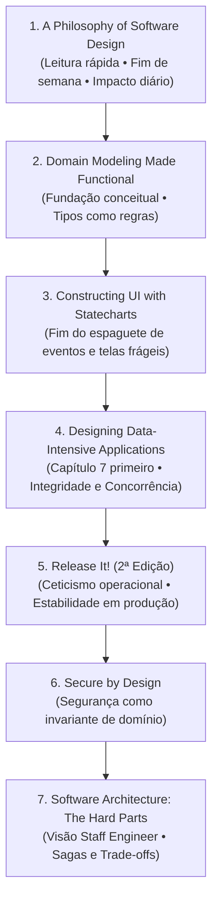

# Guia de Formação em Engenharia de Software & Recursos Essenciais

> **Objetivo:** Roteiro prático e aprofundado para elevar sua visão arquitetural, qualidade de código e robustez de sistemas em produção, fundamentado em 7 obras seminais da computação moderna com conexões diretas aos desafios reais do nosso projeto ([`insta-auto-panel`](file:///home/eduardorwll/Projects/Sandbox/src/insta-auto-panel)).

---

## 1. Os 7 Livros Fundamentais

### 1.1. Domain Modeling Made Functional
*Tackle Software Complexity with Domain-Driven Design and F#*  
**Autor:** Scott Wlaschin | **Editora:** The Pragmatic Bookshelf

#### Resumo do Conteúdo em Bullet Points
* **Álgebra de Tipos no Domínio:** Utilização de Tipos Produto (AND / Records / Interfaces) e Tipos Soma (OR / Discriminated Unions) para expressar regras de negócio diretamente no compilador.
* **Tornar Estados Ilegais Irrepresentáveis:** Se uma operação exige validação prévia ou pré-condição, a assinatura da função só aceita o tipo validado; o estado inválido não compila.
* **Eliminação da Obsessão por Primitivos (*Primitive Obsession*):** Substituição de `string` soltas, inteiros genéricos e flags por tipos nominais de domínio (ex.: `EmailAddress`, `PostStatus`, `TenantId`).
* **Pipelines Funcionais Puros:** Tratamento de regras de negócio como funções puras encadeadas (`Input -> Result<Output, DomainError>`), separando totalmente a lógica de decisão do acesso a I/O.
* **Arquitetura em Camadas Funcionais (Onion/Hexagonal):** Efeitos colaterais (leitura de disco, requisições HTTP, queries SQL) ficam estritamente nas bordas do sistema; o núcleo do domínio permanece 100% puro e determinístico.

#### O que você aprende ao ler
* Como transformar o compilador do TypeScript no seu auditor de código mais implacável.
* Como eliminar classes inteiras de bugs de validação sem precisar encher o código de blocos `if/else` espalhados.
* A abandonar a proliferação de booleanos interdependentes e substituí-los por máquinas de estado claras expressas em tipos discriminados.

#### A Lente Mental & Conexão com o Código do Projeto
* **Lente Mental:** *"Tornar Estados Ilegais Irrepresentáveis"*. Quando você tem 7 booleans independentes (`isRendering`, `isGeneratingBg`, `isGeneratingAI`, `isSaving`, `saveSuccess`...), você criou $2^7 = 128$ combinações possíveis no espaço de estados da UI, das quais 120 são estados contraditórios ou impossíveis.
* **O que torna visível no nosso código:**
  * O *Boolean Soup* em [`DesignStudioTab.tsx`](file:///home/eduardorwll/Projects/Sandbox/src/insta-auto-panel/src/client/components/DesignStudioTab.tsx#L159-L178), onde flags concorrentes controlam renderização e salvamento.
  * A divergência de vocabulário de domínio (`"published"` no banco SQLite vs `"posted"` na UI) em [`schema.ts`](file:///home/eduardorwll/Projects/Sandbox/src/insta-auto-panel/src/server/db/schema.ts#L30-L38) e [`PublicationQueue.tsx`](file:///home/eduardorwll/Projects/Sandbox/src/insta-auto-panel/src/client/components/PublicationQueue.tsx#L32-L38).
  * As transições de status de publicação sendo feitas sem pré-condições tipadas nos serviços.

#### Como Ler este Livro
* **Formato:** **Capa a Capa (Linear)** nas Partes 1 e 2.
* **Por onde começar:**
  1. *Parte 1 (Understanding the Domain):* Capítulos 1 a 4. Mostra como extrair o domínio com especialistas de negócio e mapear eventos.
  2. *Parte 2 (Modeling the Domain):* Capítulos 5 a 8. O ápice do livro: como modelar fluxos e regras usando tipos algébricos (embora use F#, a sintaxe é tão limpa que parece pseudocódigo e traduz diretamente para o TypeScript).
  3. *Parte 3 (Implementation & Persistence):* Pode ser lida como **Consulta/Referência** para entender como conectar o domínio puro com banco de dados e serialização JSON.

---

### 1.2. Constructing the User Interface with Statecharts
**Autor:** Ian Horrocks | **Editora:** Addison-Wesley

#### Resumo do Conteúdo em Bullet Points
* **Falácia do Event-Driven Espaguete:** Por que tratar eventos de mouse, toque e timers diretamente em manipuladores soltos (`onClick`, `useEffect`) invariavelmente leva a estados inconsistentes e telas travadas.
* **Formalismo dos Statecharts de David Harel:** Hierarquia de estados (estados aninhados/subestados), ortogonalidade (estados paralelos concorrentes) e ações de transição (`onEntry`, `onExit`).
* **Eliminação da "Flagitis" (Variáveis de Controle Ocultas):** Identificação do antipadrão de adicionar `let isSubmitting = true` ou `let ignoreClick = true` a cada bug reportado pelo usuário.
* **Separação Explícita entre Lógica de Navegação e Renderização:** A UI torna-se uma projeção pura do estado atual do Statechart; as interações do usuário disparam eventos, não mutações diretas.

#### O que você aprende ao ler
* A projetar o comportamento e o ciclo de vida de uma tela complexa no papel antes de escrever uma única tag JSX ou manipulador de evento.
* Como eliminar de forma definitiva problemas crônicos de duplo-clique, requisições sobrepostas e perda de foco ao alternar abas.
* A fundamentação teórica de bibliotecas modernas como **XState**, permitindo desenhar fluxos de telas imunes a condições de corrida.

#### A Lente Mental & Conexão com o Código do Projeto
* **Lente Mental:** *"O Fim do Código Event-Driven Espaguete em UIs"*. Interfaces complexas escondem uma máquina de estados implícita. Se você não modelá-la explicitamente, os bugs de sincronização entre a tela e o backend se tornarão infinitos.
* **O que torna visível no nosso código:**
  * A condição de corrida quando o usuário clica em "Preencher com IA" e altera a seleção de dia antes da resposta HTTP retornar em [`DesignStudioTab.tsx`](file:///home/eduardorwll/Projects/Sandbox/src/insta-auto-panel/src/client/components/DesignStudioTab.tsx#L413-L448).
  * O ciclo de boot e reconciliação de autenticação em [`App.tsx`](file:///home/eduardorwll/Projects/Sandbox/src/insta-auto-panel/src/client/App.tsx#L273-L309).
  * A perda de alterações não salvas (*dirty state*) ao alternar entre as abas do painel sem confirmação.

#### Como Ler este Livro
* **Formato:** **Capa a Capa (Capítulos Iniciais)** + **Consulta Teórica**.
* **Por onde começar:**
  1. *Capítulos 1 a 4:* Leitura obrigatória e linear. Apresenta os problemas dos métodos convencionais de desenvolvimento de UI e introduz a notação formal de Harel.
  2. *Capítulos 5 a 8:* O método de engenharia passo a passo para construir a especificação da UI.
  3. *Capítulos posteriores:* Estudos de caso (implementados originalmente em linguagens legadas como C++/MFC); leia superficialmente apenas para absorver a transição do diagrama para o código.

---

### 1.3. Designing Data-Intensive Applications (DDIA)
**Autor:** Martin Kleppmann | **Editora:** O'Reilly Media

#### Resumo do Conteúdo em Bullet Points
* **Pilares de Sistemas de Dados:** Confiabilidade (*Reliability*), Escalabilidade (*Scalability*) e Manutenibilidade (*Maintainability*).
* **Anatomia de Transações e Níveis de Isolamento (ACID):** *Dirty Reads*, *Non-repeatable Reads*, *Lost Updates*, *Write Skew* e *Phantom Reads*, e como o isolamento de Snapshot e Serializável os previnem.
* **Falhas Parciais (*Partial Failures*):** Por que em sistemas reais partes de uma operação podem falhar enquanto outras funcionam, e por que a suposição de "tudo ou nada" sem transações quebra dados em produção.
* **O Mito do *Dual-Write* Seguro:** Os perigos de tentar atualizar duas fontes de dados independentes (ex.: SQLite + Sistema de Arquivos) sem um protocolo transacional ou log de reconciliação.
* **Modelos de Concorrência e Replicação:** Detecção de conflitos, semântica *Check-Then-Act* (TOCTOU) e arquiteturas baseadas em logs de eventos.

#### O que você aprende ao ler
* A adquirir uma paranoia saudável sobre o ciclo de vida dos dados e onde eles se corrompem sob concorrência.
* Como escolher o nível de consistência adequado para cada funcionalidade sem sacrificar desnecessariamente o desempenho.
* Como desenhar operações de gravação atômicas e idempotentes imunes a reinicializações bruscas do servidor.

#### A Lente Mental & Conexão com o Código do Projeto
* **Lente Mental:** *"Fontes da Verdade, Dual-Writes, Atomicidade e Concorrência"*. Se você altera o banco de dados e grava um arquivo no disco em duas instruções separadas, o sistema fatalmente ficará em estado corrupto quando a máquina travar entre os dois comandos.
* **O que torna visível no nosso código:**
  * Loops de gravação e atualização executados fora de [`db.transaction()`](file:///home/eduardorwll/Projects/Sandbox/src/insta-auto-panel/src/server/services/schedules/schedule-service.ts#L84-L114).
  * O *Dual-Write* entre `Bun.write` no disco e o `sqlite.run` em [`photos.ts`](file:///home/eduardorwll/Projects/Sandbox/src/insta-auto-panel/src/server/routes/photos.ts#L111-L132).
  * A divergência de status entre os arquivos físicos da fila do AutoSocial (`pending/published/failed`) e a coluna `posts.status` em [`autosocial.ts`](file:///home/eduardorwll/Projects/Sandbox/src/insta-auto-panel/src/server/services/export/autosocial.ts#L41-L167).
  * A corrida *Check-Then-Act* (TOCTOU) ao verificar e criar cronogramas semanais simultaneamente.

#### Como Ler este Livro
* **Formato:** **Híbrido (Leitura Estruturada + Consulta Contínua de Carreira)**.
* **Por onde começar:**
  1. *Capítulo 7 (Transactions):* **Leia primeiro!** É o capítulo mais prático e revelador sobre integridade de dados e concorrência em qualquer backend.
  2. *Capítulo 1 (Reliability, Scalability, Maintainability):* Define as métricas e terminologias de engenharia.
  3. *Capítulos 2 e 3 (Data Models e Storage & Retrieval):* Entenda como bancos relacionais e engines de armazenamento funcionam sob o capô.
  4. *Capítulos 5 e 6 (Replication & Partitioning):* Leia quando estiver projetando sistemas com réplicas ou alta disponibilidade.
  5. *Parte 3 (Derived Data):* Use como **Consulta** para sistemas de stream e processamento em lote.

---

### 1.4. A Philosophy of Software Design
**Autor:** John Ousterhout | **Editora:** Yaknyam Press

#### Resumo do Conteúdo em Bullet Points
* **A Natureza da Complexidade:** Complexidade é definida por dois sintomas: *Change Amplification* (uma mudança simples exige alterações em múltiplos arquivos) e *Cognitive Load* (quantidade de contexto mental necessária para alterar uma linha de código com segurança).
* **Módulos Profundos vs. Módulos Rasos (*Deep vs. Shallow Modules*):** As melhores abstrações possuem interfaces simples e estreitas que escondem implementações ricas e complexas. Abstrações rasas apenas adicionam indireção inútil.
* **Princípio "Define Errors Out of Existence":** Em vez de sobrecarregar a API com exceções e verificações defensivas, projete a operação de modo que o caso limite tenha uma semântica natural óbvia (ex.: deletar algo inexistente é um *no-op*, e não uma exceção fatal).
* **Vazamento de Conhecimento e Acoplamento Temporal:** Quando duas rotinas compartilham um detalhe de implementação não documentado ou exigem ser chamadas em uma ordem estrita sem que a API imponha essa ordem.
* **Comentários de Alto Valor:** Escrever documentação focada no *porquê* das decisões e nas invariantes que não podem ser inferidas diretamente pelo código.

#### O que você aprende ao ler
* A projetar APIs internas e interfaces de serviço onde é fácil fazer o certo e quase impossível errar.
* A reconhecer quando uma refatoração está de fato simplificando a arquitetura ou apenas espalhando a complexidade pela base de código.
* Como reduzir o custo de manutenção futura diminuindo o número de suposições implícitas entre módulos.

#### A Lente Mental & Conexão com o Código do Projeto
* **Lente Mental:** *"Vazamento de Conhecimento, Acoplamento Temporal e 'Design Errors Out of Existence'"*. Se para salvar um post o cliente precisa orquestrar duas chamadas consecutivas respeitando uma ordem estrita e gerenciando identificadores temporários, a API do backend falhou em ser um módulo profundo.
* **O que torna visível no nosso código:**
  * O acoplamento temporal em que o frontend precisa chamar `PUT /api/posts/:id` e imediatamente depois `PUT /api/posts/:id/slides` em [`DesignStudioTab.tsx`](file:///home/eduardorwll/Projects/Sandbox/src/insta-auto-panel/src/client/components/DesignStudioTab.tsx#L377-L398), gerando perda de dados com identificadores temporários (`temp_slide_...`).
  * A triplicação de utilitários de data (como `getMonday()`) espalhados sem um módulo claro de domínio.
  * A triplicação de definições de schema SQLite entre seeds, migrations e queries manuais.

#### Como Ler este Livro
* **Formato:** **Capa a Capa (Leitura Rápida e Direta)**.
* **Por onde começar:**
  * Livro curto (~170 páginas). Leia linearmente do Capítulo 1 ao 21. Pode ser lido integralmente em um fim de semana e causa impacto imediato na qualidade do código que você escreve na segunda-feira seguinte.

---

### 1.5. Release It! Design and Deploy Production-Ready Software (2ª Edição)
**Autor:** Michael T. Nygard | **Editora:** The Pragmatic Bookshelf

#### Resumo do Conteúdo em Bullet Points
* **Postura do Engenheiro Cético (*Cynical Engineering*):** Projetar sistemas assumindo que a rede vai falhar, serviços externos vão travar, discos vão encher e usuários farão requisições absurdas.
* **Antipadrões de Estabilidade:** *Unbounded Result Sets / In-Memory Collections* (acúmulo infinito de chaves em memória), *Cascading Failures*, *Blocked Threads* e *Self-Denial Attacks*.
* **Padrões de Estabilidade:** *Circuit Breakers* (interrupção preventiva de chamadas a provedores fora do ar), *Bulkheads* (compartimentalização de falhas para evitar colapso geral), *Timeouts* e *Fail Fast*.
* **Degradação Graciosa:** Estratégias para que a aplicação continue operando com recursos reduzidos quando dependências externas falham (ex.: fallback de IA generativa para modelos locais ou templates pré-definidos).
* **Higiene Operacional de Recursos:** Fechamento estrito de conexões, descarte de arquivos temporários e limpeza de caches órfãos.

#### O que você aprende ao ler
* A antecipar como o seu software se comportará após rodar ininterruptamente por 60 dias em produção, e não apenas nos 5 minutos de teste no ambiente de desenvolvimento local.
* Como blindar sua aplicação contra custos astronômicos ou lentidão decorrentes de dependências instáveis de APIs de terceiros.
* Como criar mecanismos de contenção de falhas que evitam o efeito dominó no servidor.

#### A Lente Mental & Conexão com o Código do Projeto
* **Lente Mental:** *"Antipadrões de Estabilidade, Vazamentos Lentos e Falhas em Cascata"*. Toda coleção em memória sem teto máximo ou política de expiração é uma bomba-relógio de esgotamento de RAM (Out Of Memory) aguardando para explodir em produção.
* **O que torna visível no nosso código:**
  * O crescimento ilimitado de Maps em memória (`loginAttempts` em [`session.ts`](file:///home/eduardorwll/Projects/Sandbox/src/insta-auto-panel/src/server/services/auth/session.ts#L15) e `rpmBuckets` em [`quota-guard.ts`](file:///home/eduardorwll/Projects/Sandbox/src/insta-auto-panel/src/server/services/ai/quota-guard.ts#L13)), resolvidos com o [`BoundedTtlMap`](file:///home/eduardorwll/Projects/Sandbox/src/insta-auto-panel/src/server/utils/bounded-map.ts).
  * O acúmulo contínuo de arquivos de imagem órfãos em `data/uploads/` e `data/renders/` após a deleção lógica de posts no banco.
  * A ausência de uma máquina de estados explícita para fallback gracioso quando os provedores de IA externa (OpenAI/Gemini) falham ou atingem o limite de taxa (*rate limit*).

#### Como Ler este Livro
* **Formato:** **Híbrido (Leitura Contínua da Parte I + Consulta Operacional das Demais)**.
* **Por onde começar:**
  1. *Parte I (Stability):* Capítulos 1 a 6. Leitura fascinante, estruturada a partir de casos reais de desastres em sistemas de grande porte. Leia do início ao fim com prioridade máxima.
  2. *Parte II (Production Tooling):* Foco em observabilidade, métricas e logs estruturados.
  3. *Partes III e IV:* Use como **Guia de Consulta** ao planejar infraestrutura, implantação contínua e monitoramento de saúde do sistema.

---

### 1.6. Secure by Design
**Autores:** Dan Bergh Johnsson, Daniel Deogun & Daniel Sawano | **Editora:** Manning

#### Resumo do Conteúdo em Bullet Points
* **Segurança Baseada no Domínio:** Em vez de tratar segurança como uma camada superficial de *firewalls* ou verificações manuais de `if` no controller, incorpore as regras de autorização na própria integridade dos objetos de negócio.
* **Conceito de *Domain Primitives*:** Objetos imutáveis que encapsulam validação estrita no construtor. Se uma instância existe, ela é garantidamente válida e segura.
* **Prevenção Arquitetural de IDOR / BOLA:** Isolamento automático de dados entre empresas (*multi-tenant*) ao tornar o contexto de pertencimento (`companyId`) parte obrigatória de qualquer repositório ou comando de negócio.
* **Princípio do "Fail Closed":** Em qualquer falha de validação, erro de autorização ou exceção desconhecida, o sistema assume o estado de menor privilégio e nega a operação imediatamente.
* **Imutabilidade e Integridade de Fluxo:** Garantir que entidades de negócio não sofram mutações parciais ou transições de estado arbitrárias por agentes não autorizados.

#### O que você aprende ao ler
* Como criar sistemas onde o desenvolvedor é protegido contra esquecer verificações de permissão em novos endpoints.
* A transformar regras de segurança em invariantes de compilação, tornando invasões do tipo IDOR (*Insecure Direct Object Reference*) estruturalmente inviáveis.
* Como criar primitivas reutilizáveis que higienizam dados na entrada, impedindo injeções de código ou corrupção de estado.

#### A Lente Mental & Conexão com o Código do Projeto
* **Lente Mental:** *"Segurança como Invariante de Domínio, não como if na Rota"*. Se um método de atualização de slide permite atualizar qualquer registro apenas passando o `slideId`, o método possui uma falha de design que convida a vulnerabilidades IDOR, mesmo que a rota HTTP faça verificações.
* **O que torna visível no nosso código:**
  * O método `updatePostSlidesContent` em [`schedule-service.ts`](file:///home/eduardorwll/Projects/Sandbox/src/insta-auto-panel/src/server/services/schedules/schedule-service.ts#L260-L278), que atualizava lâminas pelo identificador do slide sem amarrar a restrição `AND post_id = :postId`.
  * Endpoints de mutação (`PUT /api/posts/:id` e `DELETE /api/posts/:id`) que exigem a presença estrita e a validação do `companyId` do inquilino ativo em todas as operações de banco.

#### Como Ler este Livro
* **Formato:** **Capa a Capa (Partes 1 e 2)**.
* **Por onde começar:**
  1. *Parte 1 (Why Security by Design Matters):* Capítulos 1 a 3. Estabelece a filosofia e demonstra por que a abordagem tradicional de segurança "por remendo" sempre fracassa.
  2. *Parte 2 (Design Patterns for Security):* Capítulos 4 a 8. O coração prático: padrões de *Domain Primitives*, entidades seguras e máquinas de estado invioláveis.
  3. *Parte 3 (Taking Security to the Boundary):* Leitura complementar sobre limites do sistema, I/O e APIs externas.

---

### 1.7. Software Architecture: The Hard Parts
*Modern Input for Objective Decisions*  
**Autores:** Neal Ford, Mark Richards, Pramod Sadalage & Zhamak Dehghani | **Editora:** O'Reilly Media

#### Resumo do Conteúdo em Bullet Points
* **A Falácia das "Melhores Práticas":** Na arquitetura de software não existem soluções perfeitas; toda escolha arquitetural é uma troca deliberada entre compensações (*trade-offs*). O papel do arquiteto é encontrar a solução "menos pior" para o contexto específico.
* **Decomposição e Granularidade de Serviços e Dados:** Como dividir responsabilidades entre módulos e serviços avaliando a coesão transacional e a frequência de mudanças.
* **Padrões de Comunicação e Sagas Distribuídas:** Estratégias para coordenar transações em múltiplos passos (orquestração vs. coreografia) quando o processo envolve etapas heterogêneas (banco de dados, sistema de arquivos e serviços de terceiros).
* **Acoplamento Semântico e Contratos Compartilhados:** Identificação de acoplamentos invisíveis onde módulos distintos mantêm suposições não explícitas sobre a formatação ou o ciclo de vida dos dados.
* **Registros de Decisão Arquitetural (ADRs):** Metodologia para formalizar e documentar decisões técnicas, justificativas e compensações assumidas.

#### O que você aprende ao ler
* A pensar como um *Staff / Principal Engineer*: articulando trade-offs de forma clara, técnica e objetiva em vez de defender opiniões dogmáticas.
* Como gerenciar consistência de dados em operações complexas de múltiplos estágios sem recorrer a bloqueios globais que destroem a performance.
* Como criar fronteiras limpas entre subsistemas gráficos, motores de renderização e rotinas de persistência.

#### A Lente Mental & Conexão com o Código do Projeto
* **Lente Mental:** *"Análise de Trade-offs, Acoplamento Semântico e Sagas Transacionais"*. Quando dois módulos assumem formatos diferentes para o mesmo dado ou quando o cliente e o servidor renderizam o mesmo template com comportamentos divergentes, existe um acoplamento semântico mal resolvido.
* **O que torna visível no nosso código:**
  * O descompasso entre o motor de desenho do elemento `<canvas>` 2D no navegador em [`useOpenDesignCanvas.ts`](file:///home/eduardorwll/Projects/Sandbox/src/insta-auto-panel/src/client/hooks/useOpenDesignCanvas.ts) e a geração de PNG pelo backend no disco quando o cliente não envia `clientSlidePngs` em [`template-engine.ts`](file:///home/eduardorwll/Projects/Sandbox/src/insta-auto-panel/src/server/services/design/template-engine.ts#L335-L388).
  * O fluxo de publicação do AutoSocial envolvendo gravação de arquivos de controle, renderização de slides e enfileiramento sem uma saga transacional clara de compensação em caso de erro no meio do caminho.

#### Como Ler este Livro
* **Formato:** **Manual Híbrido (Primeira Metade Sequencial + Segunda Metade por Consulta)**.
* **Por onde começar:**
  1. *Capítulos 1 e 2:* Fundamentos sobre como analisar e estruturar trade-offs arquiteturais.
  2. *Capítulos 8 e 9 (Transactional Sagas):* O ponto central para backend: como coordenar operações que tocam banco e serviços externos sem transações de duas fases (2PC).
  3. *Capítulos 10 a 14:* Consulte sob demanda conforme surgirem discussões sobre separação de serviços, divisão de contratos ou bancos de dados poliglota.

---

## 2. Roteiro de Leitura Recomendado

Para maximizar a absorção prática e colher benefícios imediatos no desenvolvimento diário, siga esta ordem de leitura:



---

## 3. Objetivos Estratégicos de Formação em Engenharia

### 3.1. Curto Prazo (Semanas 1 a 4) — *Higiene Arquitetural e Código Robusto no Cotidiano*
* [ ] **Eliminar o *Boolean Soup* no Frontend:** Mapear os componentes de maior complexidade e substituir combinações de flags booleanas por uniões discriminadas do TypeScript ou máquinas de estado simples.
* [ ] **Adotar Módulos Profundos nas Rotas e Serviços:** Redesenhar APIs internas que exigem chamadas consecutivas interdependentes, unificando-as em operações atômicas no backend (aplicando o princípio *Define Errors Out of Existence*).
* [ ] **Blindar Coleções em Memória:** Auditar todos os caches, filas e mapas em memória na aplicação garantindo que possuam capacidade máxima delimitada (*bounded*) e expiração por tempo (TTL).

### 3.2. Médio Prazo (Meses 2 a 4) — *Confiabilidade de Produção, Resiliência e Concorrência*
* [ ] **Transacionalidade Estrita em Dados e Arquivos:** Garantir que todas as operações compostas no banco SQLite ocorram sob blocos `db.transaction()`, e estruturar rotinas de compensação para mitigar falhas parciais em *dual-writes* com o sistema de arquivos.
* [ ] **Isolamento de Segurança Multi-Tenant por Construção:** Encapsular o `companyId` nos contratos de repositório e serviços, eliminando a dependência de verificações manuais de autorização nas rotas HTTP.
* [ ] **Resiliência e Circuit Breakers em APIs Externas:** Implementar mecanismos de timeout, tentativas com recuo exponencial (*exponential backoff*) e degradação graciosa para chamadas aos provedores de IA e geração de imagens.

### 3.3. Longo Prazo (Meses 5 a 12) — *Arquitetura Distribuída, Trade-Offs e Visão de Staff Engineer*
* [ ] **Domínio de Sagas Transacionais:** Projetar fluxos de longa duração e pipelines assíncronos (como renderização de mídias e publicações automáticas) utilizando o padrão Saga com orquestração clara e ações de compensação.
* [ ] **Documentação Sistemática de Decisões (ADRs):** Padronizar a criação de *Architecture Decision Records* para cada mudança estrutural na base de código, explicitando trade-offs e alternativas descartadas.
* [ ] **Harmonização de Motores Gráficos e Contratos:** Unificar as regras de geração visual entre o cliente (HTML/Canvas) e o servidor (Node/Bun/Worker), eliminando divergências de fidelidade e acoplamentos semânticos ocultos.

---

## 4. Leitores de Markdown Open Source Recomendados para Android

Para acompanhar esta documentação, diagramas Mermaid e notas de estudo no celular, foram pesquisadas e selecionadas as **3 melhores opções de código aberto**, leves, com visual moderno e suporte a diagramas:

| Aplicativo | Foco Principal | Suporte a Mermaid | Licença / Onde Baixar |
| :--- | :--- | :---: | :--- |
| **1. PilcrowMD** | Leitura moderna & bonita focada em Markdown rico | **Sim (Nativo e Offline)** | GPL v3 • [GitHub](https://github.com/pilcrowmd/pilcrow) / F-Droid |
| **2. Zettel Notes** | Gestão de notas estruturadas & Zettelkasten | **Sim (Plugin Oficial)** | Open Source • [GitHub](https://github.com/zettelnotes/zettel-notes) / F-Droid |
| **3. Markor** | Máxima leveza, velocidade e autonomia | Via extensões / HTML | GPL v3 • [GitHub](https://github.com/gsantner/markor) / F-Droid |

### 4.1. PilcrowMD *(A Escolha Recomendada para Diagramas e Estética)*
* **Destaques:** É um dos leitores e editores mais elegantes e focados em privacidade para Android. Possui **renderização nativa de blocos Mermaid** (` ```mermaid `) executando a biblioteca oficial em um componente seguro e offline, sem depender de conexão com a internet.
* **Recursos:** Suporte completo a GitHub Flavored Markdown (tabelas, task lists), fórmulas matemáticas em KaTeX, visual limpo, modo escuro refinado e tipografia confortável para leituras longas.
* **Ideal para:** Quem quer abrir arquivos `.md` contendo diagramas de arquitetura, tabelas e notas de engenharia com renderização idêntica à do GitHub.

### 4.2. Zettel Notes *(A Escolha para Conhecimento Interconectado)*
* **Destaques:** Aplicativo local-first extremamente poderoso para quem pratica Zettelkasten ou organiza notas de estudo. Suporta diagramas Mermaid através do seu **Plugin Oficial de Mermaid**, que permite pré-visualizar, aplicar zoom, arrastar (*pan*) e exportar os diagramas como SVG ou PNG.
* **Recursos:** Armazenamento em arquivos locais puros (sem lock-in), suporte a links wiki (`[[Nota]]`), metadados YAML frontmatter, sincronização flexível via Git, WebDAV ou Syncthing.
* **Ideal para:** Quem deseja ler o guia, criar anotações de estudo conectadas a cada livro e visualizar diagramas estruturais com controle de zoom.

### 4.3. Markor *(A Escolha para Leveza Extrema e Desempenho)*
* **Destaques:** O leitor e editor de Markdown de código aberto mais tradicional e consagrado do ecossistema Android. É incrivelmente rápido, inicializa instantaneamente e consome o mínimo absoluto de bateria e memória.
* **Recursos:** Motor de renderização Flexmark robusto, alternância rápida entre modo de visualização e edição, suporte a listas de tarefas (Todo.txt) e navegação direta no sistema de pastas do celular.
* **Ideal para:** Quem prioriza velocidade instantânea, baixo consumo de recursos e manipulação direta de arquivos locais sincronizados via Git ou Syncthing.
