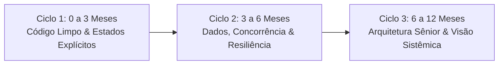

# 🧭 Trilha de Formação em Visão de Engenharia & Arquitetura de Software

> **Destinatário:** Eduardo R. W. L.  
> **Propósito:** Catálogo curado de livros, artigos seminais, recursos práticos e plano de objetivos estratégicos para desenvolver a mentalidade de engenharia de software sênior — enxergando além do "caminho feliz" para antecipar falhas invisíveis, modelar sistemas robustos e liderar decisões técnicas.  
> **Locais de Consulta:** `~/Antigravity/guia-leitura-recursos-engenharia.md` e `~/Downloads/guia-leitura-recursos-engenharia.md`

---

## 🏛️ Por Que Desenvolver a "Visão de Engenharia"?

Um desenvolvedor iniciante ou intermediário costuma focar em **fazer funcionar no caminho feliz**: a sintaxe compila, os testes unitários básicos passam e a tela renderiza.

A **visão de engenharia sênior** opera sob outra pergunta:  
> *"O que este código permite que aconteça quando a rede oscilar, o disco falhar, dois usuários clicarem simultaneamente, a memória acumular dados por 6 meses ou uma etapa falhar pela metade?"*

Esta trilha foi desenhada para calibrar esse olhar mental.

---

## 📚 1. Os Livros Fundamentais (Classificados por Lente Mental)

### Categoria A: Modelagem de Domínio & Estados Explícitos (Fim do *Boolean Soup*)

#### 1. *Domain Modeling Made Functional* — Scott Wlaschin
- **Ideia Central:** *Make Illegal States Unrepresentable* (Torne estados ilegais impossíveis de representar).
- **O Que Transforma na Sua Mente:** Ensina a usar sistemas de tipos algébricos (uniões discriminadas / sum types) e máquinas de estado finitas para que regras de negócio inválidas sequer compilem, eliminando centenas de `if/else` defensivos espalhados.
- **Onde Brilha:** Modelagem de ciclo de vida de entidades (pedidos, postagens, pagamentos, onboarding).

#### 2. *Constructing the User Interface with Statecharts* — Ian Horrocks
- **Ideia Central:** UIs não são coleções de flags booleanas; são Statecharts determinísticos (baseados na teoria de David Harel).
- **O Que Transforma na Sua Mente:** Elimina o pesadelo de UIs com múltiplos `isEditing`, `isSaving`, `isLoading`, substituindo-os por transições matemáticas fechadas onde condições de corrida entre cliques e requisições assíncronas deixam de existir.

#### 3. *Secure by Design* — Dan Bergh Johnsson, Daniel Deogun & Daniel Sawano
- **Ideia Central:** Segurança não é um firewall externo; é a preservação de invariantes de domínio em tipos ricos (*Domain Primitives*).
- **O Que Transforma na Sua Mente:** Mostra como substituir primitivos soltos (`string`, `number`) por objetos de valor que garantem integridade na construção (ex.: `Quantity`, `InstagramHandle`, `TenantId`), prevenindo injeções e vazamentos multi-tenant por definição.

---

### Categoria B: Dados, Concorrência & Falhas Parciais (O Mundo Real)

#### 4. *Designing Data-Intensive Applications (DDIA)* — Martin Kleppmann
- **Ideia Central:** A bíblia moderna da engenharia de dados, transações e consistência.
- **O Que Transforma na Sua Mente:** Desmistifica termos como ACID, isolamento de transações, *write skew*, corridas TOCTOU, replicação, *dual-write drift* e consenso distribuído. Após ler Kleppmann, você nunca mais olhará para um `INSERT` ou gravação em disco sem pensar: *"e se cair agora?"*.

#### 5. *Release It! Design and Deploy Production-Ready Software (2ª Edição)* — Michael T. Nygard
- **Ideia Central:** Sistemas vivos morrem por vazamento lento de recursos e reações em cadeia.
- **O Que Transforma na Sua Mente:** Apresenta padrões canônicos de sobrevivência em produção: *Circuit Breaker*, *Bulkheads*, *Timeouts*, *Steady State* (limpeza periódica de disco e arquivos órfãos) e *Bounded Result Sets* (limites e TTLs rígidos para mapas em memória).

#### 6. *Software Architecture: The Hard Parts* — Neal Ford, Mark Richards, Pramod Sadalage & Zhamak Dehghani
- **Ideia Central:** Não existem decisões perfeitas em arquitetura; existem apenas trade-offs conscientemente negociados.
- **O Que Transforma na Sua Mente:** Foco em transações distribuídas, sagas compensatórias, separação vs. junção de dados e como coordenar bancos relacionais com arquivos e serviços sem travar o sistema.

---

### Categoria C: Design de Código, Complexidade & Refatoração

#### 7. *A Philosophy of Software Design* — John Ousterhout
- **Ideia Central:** O maior inimigo do software é a complexidade cognitiva; módulos devem ser "profundos" (*Deep Modules*: interface simples, implementação rica).
- **O Que Transforma na Sua Mente:** Ensina o princípio *Define Errors Out of Existence* (desenhe APIs de tal forma que o erro não possa acontecer, em vez de exigir tratamento manual a cada chamada) e ataca o acoplamento temporal.

#### 8. *Working Effectively with Legacy Code* — Michael Feathers
- **Ideia Central:** Código legado é simplesmente código sem testes automatizados.
- **O Que Transforma na Sua Mente:** O arsenal prático para entrar em qualquer codebase legada, encontrar costuras (*seams*), escrever testes de caracterização (que travam o comportamento real atual) e refatorar sem medo de regressão.

#### 9. *Refactoring: Improving the Design of Existing Code (2ª Edição)* — Martin Fowler
- **Ideia Central:** Refatoração é a preservação estrita de comportamento observável através de micromovimentos atômicos.
- **O Que Transforma na Sua Mente:** O vocabulário universal de *code smells* (Bloaters, Couplers, Dispensables) e o catálogo de tratamentos cirúrgicos.

#### 10. *The Pragmatic Programmer: 20th Anniversary Edition* — David Thomas & Andy Hunt
- **Ideia Central:** Postura profissional de engenharia, ortogonalidade, desenvolvimento por traçadores (*Tracer Bullets*) e a teoria das janelas quebradas.

---

## 📄 2. Artigos & Papers Seminais (Leituras Curtas de Altíssimo Impacto)

1. **David Harel (1987) — *Statecharts: A Visual Formalism for Complex Systems***
   - O artigo original de 1987 que inventou Statecharts para a aviônica e sistemas reativos. Ensina como hierarquias e concorrência ortogonal resolvem a explosão combinatória de estados.
2. **J.H. Saltzer, D.P. Reed & D.D. Clark (1984) — *End-to-End Arguments in System Analysis***
   - A tese clássica de que garantias de baixo nível não dispensam a verificação de ponta a ponta na aplicação (ex.: reconciliação banco ↔ fila de arquivos).
3. **Leslie Lamport (1978) — *Time, Clocks, and the Ordering of Events in a Distributed System***
   - Por que timestamps de relógios físicos mentem e como pensar em causalidade lógica e ordem de eventos.
4. **Rich Hickey (2011) — *Simple Made Easy* (Palestra / Transcrição)**
   - A distinção indispensável entre "simples" (não entrelaçado, unifocado) e "fácil" (familiar, próximo à mão). O guia definitivo contra código espaguete.
5. **Van Clief & McDermott (2026) — *Interpretable Context Methodology (ICM)* (arXiv:2603.16021)**
   - O artigo que fundamenta o `icm-architect`: substituir frameworks orquestradores de IA pela estrutura e contratos do sistema de arquivos.

---

## 🌐 3. Blogs de Engenharia, Post-Mortems & Recursos Práticos

### Engenheiros & Escritores Imperdíveis
- **Brandur Leach ([brandur.org](https://brandur.org)):** Engenheiro do Stripe. Seus ensaios sobre *Idempotency Keys*, *Transactional Outbox Pattern* e *Soft Deletion Considered Harmful* são referências obrigatórias para quem lida com APIs e bancos de dados.
- **Marc Brooker ([brooker.co.za/blog](https://brooker.co.za/blog)):** VP e Distinguished Engineer da AWS. Artigos profundos sobre sistemas distribuídos, filas, metastabilidade e concorrência real.
- **Dan Luu ([danluu.com](https://danluu.com)):** Análises empíricas cirúrgicas sobre hardware, rede, bugs reais e por que sistemas simples superam sistemas complexos.
- **Martin Fowler Bliki ([martinfowler.com](https://martinfowler.com)):** Enciclopédia viva de arquitetura, padrões de microsserviços, CI/CD e refatoração.
- **Emil Kowalski ([emilkowal.ski](https://emilkowal.ski)):** O padrão de ouro para design engineering, física de micro-interações e animações com foco em performance e feedback tátil.

### Post-Mortems de Produção (Aprendendo com Erros Alheios)
- **GitHub Incident Reports ([github.blog](https://github.blog/tag/incident-report/)):** Lições reais sobre degradação de MySQL, concorrência de Redis e falhas de particionamento.
- **Cloudflare Outage Post-Mortems ([blog.cloudflare.com](https://blog.cloudflare.com/tag/outage/)):** Aulas práticas sobre bugs de regex, estouros de memória e comportamento sob tráfego massivo.

---

## 🎯 4. Plano de Objetivos Estratégicos (Curto, Médio e Longo Prazo)

Para que essa lista não se torne apenas uma estante de livros acumulados, estruture seu aprendizado nestes **3 ciclos de objetivos com metas verificáveis**:

---

### 🟢 Ciclo 1: Imediato a Curto Prazo (Mês 1 a 3) — *Eliminando o Caos Local*
**Foco:** Estados explícitos, modelagem de tipos e disciplina de TDD.

#### Leituras do Ciclo:
1. *Domain Modeling Made Functional* (Scott Wlaschin)
2. *Constructing the User Interface with Statecharts* (Ian Horrocks)
3. *A Philosophy of Software Design* (John Ousterhout)

#### Objetivos Práticos Verificáveis:
- [ ] **Morte ao *Boolean Soup*:** Nunca mais criar um componente ou entidade com 3 ou mais flags booleanas (`isLoading`, `isSaving`, `isError`). Modelar todo fluxo como uma união discriminada ou máquina de estados formal.
- [ ] **Domínio Impossível de Invalidar:** Praticar em seus projetos pessoais ou profissionais a criação de tipos que tornam estados inválidos impossíveis de compilar.
- [ ] **Prática Fluida de TDD:** Escrever o teste que falha (Red) antes de qualquer implementação de rota ou serviço (Green).
- [ ] **Adoção do Paradigma Why-First:** Treinar a escrita de breves justificativas técnicas e trade-offs assumidos antes de iniciar pull requests ou commits relevantes.

---

### 🟡 Ciclo 2: Médio Prazo (Mês 3 a 6) — *Concorrência, Dados e Resiliência*
**Foco:** Integridade transacional, fronteiras de banco de dados e estabilidade em produção.

#### Leituras do Ciclo:
1. *Designing Data-Intensive Applications* (Martin Kleppmann) — Capítulos sobre Transações, Replicação e Modelos de Dados.
2. *Release It!* (Michael T. Nygard)
3. Artigos de Brandur Leach sobre Idempotência e Transações.

#### Objetivos Práticos Verificáveis:
- [ ] **Visão de Transações ACID e Dual-Write:** Olhar para qualquer fluxo que grave em banco e sistema de arquivos e desenhar imediatamente o mecanismo de reconciliação, idempotência e compensação.
- [ ] **Prevenção de Corridas TOCTOU:** Identificar onde existem consultas do tipo *check-then-act* e aplicar travas transacionais (`onConflictDoNothing`, `SELECT FOR UPDATE` ou índices únicos).
- [ ] **Coleções Blindadas:** Nunca instanciar um `Map` ou cache em memória sem definir limite de entradas (`MAX_ENTRIES`) e política de expurgo (TTL / LRU).
- [ ] **Limpeza de Arquivos Órfãos:** Garantir que rotinas de exclusão no banco sempre façam a coleta simétrica de arquivos e recursos associados no disco.

---

### 🟣 Ciclo 3: Longo Prazo (Mês 6 a 12) — *Arquitetura Sistêmica & Liderança Técnica*
**Foco:** Design de sistemas complexos, orquestração e navegação de trade-offs.

#### Leituras do Ciclo:
1. *Software Architecture: The Hard Parts* (Neal Ford et al.)
2. *Secure by Design* (Dan Bergh Johnsson et al.)
3. *Working Effectively with Legacy Code* (Michael Feathers)
4. Artigo ICM (Van Clief & McDermott, 2026).

#### Objetivos Práticos Verificáveis:
- [ ] **Pensamento em Trade-offs (Trade-off Thinking):** Parar de buscar a "solução perfeita" e saber defender decisões técnicas fundamentando quais problemas estão sendo resolvidos e quais custos foram deliberadamente aceitos.
- [ ] **Isolamento Estrito Multi-Tenant:** Projetar esquemas de banco e APIs onde seja matematicamente impossível um cliente vazar dados para outro através de queries compostas.
- [ ] **Arquitetura Orientada a Agentes (ICM):** Saber transformar fluxos complexos em estruturas de pastas e contratos Markdown limpos, onde agentes de IA trabalhem com alto determinismo e zero desperdício de contexto.
- [ ] **Revisão de Código de Alto Nível:** Conduzir code reviews que apontem fragilidades arquiteturais invisíveis (acoplamento temporal, falta de idempotência, falhas parciais) antes que o código chegue a produção.

---

## 🔍 5. Como Medir Seu Progresso (O Teste da Mudança de Percepção)

Você saberá que sua visão de engenharia mudou quando, durante uma leitura de código ou planejamento de feature, suas primeiras reações forem:

1. *"Quantos estados válidos existem aqui de verdade? Dá para desenhar num guardanapo?"*
2. *"Se esta requisição for enviada duas vezes em menos de 100ms, o que acontece?"*
3. *"Se o processo for morto com SIGKILL entre a linha 40 e a linha 41, o que sobra no banco?"*
4. *"Onde mais esse dado está guardado? Quem sincroniza quando houver divergência?"*
5. *"Qual é o limite de memória disso daqui a 90 dias com 1.000 requisições por minuto?"*
6. *"Esta abstração é profunda (faz muito com interface simples) ou é rasa (só repassa parâmetros e adiciona camadas inúteis)?"*

---

> [!TIP]
> **Ritmo Sustentável de Estudo:** Não tente maratonar todos os livros em sequência. Escolha **1 livro a cada 3 a 4 semanas**. Leia os capítulos fundamentais e procure aplicar o conceito **no mesmo dia ou na mesma semana** em um projeto real ou de sandbox. A retenção da engenharia de software ocorre nas mãos que codam o que a mente leu.
