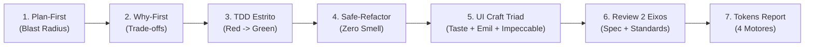
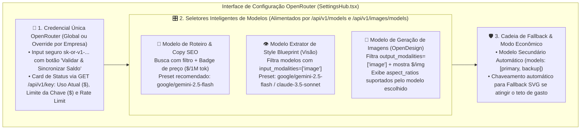
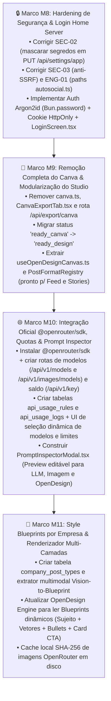

# 📘 Relatório Consolidado de Engenharia, Segurança, Arquitetura Generalizada (`@openrouter/sdk` + Style Blueprints) e Plano de Negócio — Social Panel (`insta-auto-panel`)

> **Data:** 10 de novembro de 2026  
> **Repositório:** `/home/eduardorwll/Projects/Sandbox/src/insta-auto-panel/`  
> **Perímetro Pai:** `/home/eduardorwll/Projects/Sandbox/`  
> **Stack Base:** Bun + SQLite WAL (Drizzle ORM) + React 19 + Vite + Tailwind CSS + `@openrouter/sdk` + OpenDesign Engine + AutoSocial Queue

---

## Sumário Executivo

Este documento consolida todas as **5 Etapas** de diagnóstico, auditoria e arquitetura do **Social Panel (`insta-auto-panel`)**, incorporando:
- A **Arquitetura Generalizada de "Style Blueprints"** (extração de mapa detalhado do tipo de post por IA a partir de exemplos da empresa, 100% agnóstica de cores ou formato fixo e pronta para expansão modular para **Stories**);
- A **Integração Oficial Completa com a OpenRouter (`@openrouter/sdk`)**, incluindo descoberta dinâmica de modelos de Texto/Visão e de Imagem (`/api/v1/models` e `/api/v1/images/models`), geração unificada de imagens (`POST /api/v1/images` e multimodal chat), telemetria real de saldo/limites da chave (`GET /api/v1/key` e `openRouter.credits.getCredits()`) e painel de configuração;
- O **Plano de Refatoração Estrutural** (remoção do Canva, Login simples para Home Server, Quotas explícitas de API e **Prompt Inspector**);
- O **Plano de Negócio, Economia Unitária e Roadmap de Implementação (Marcos M8 a M11)**.

---

## 🧭 Etapa 1: Diretrizes de Agentes (Repositório + Sandbox)

Qualquer evolução de código neste repositório obedece simultaneamente ao contrato local ([AGENTS.md](file:///home/eduardorwll/Projects/Sandbox/src/insta-auto-panel/AGENTS.md)) e às 9 regras globais do diretório pai ([`Sandbox/.agents/rules/`](file:///home/eduardorwll/Projects/Sandbox/.agents/rules/)).

### 1.1. Regras de Perímetro e Infraestrutura
- **Confinamento Estrito ([boundaries.md](file:///home/eduardorwll/Projects/Sandbox/.agents/rules/boundaries.md)):** Leitura e escrita restritas à árvore do `Sandbox`. Proibido acessar chaves do host (`~/.ssh`, `~/.gnupg`, `/etc`).
- **Stack Inegociável ([AGENTS.md](file:///home/eduardorwll/Projects/Sandbox/src/insta-auto-panel/AGENTS.md#L14-L33)):** Runtime exclusivo **Bun** (`Bun.serve`, `bun test`, `bun:sqlite`, `bun add`), persistência em **SQLite WAL** com **Drizzle ORM** e validação de fronteira via **Zod**.

### 1.2. Ciclo Unificado de Engenharia


- **Plan-First ([planning.md](file:///home/eduardorwll/Projects/Sandbox/.agents/rules/planning.md)) & Why-First ([explanation.md](file:///home/eduardorwll/Projects/Sandbox/.agents/rules/explanation.md)):** Nenhuma alteração sem plano atômico, mapeamento de *blast radius* (`graft callers` / `prowl references`), justificativa técnica explícita (SOLID, Clean Architecture), trade-offs documentados, alternativas descartadas e links clicáveis `file://`.
- **TDD ([tdd.md](file:///home/eduardorwll/Projects/Sandbox/.agents/rules/tdd.md)) & Commits Atômicos:** Ciclo **Red ➔ Green ➔ Refactor**. Cada ticket gera 1 commit semântico após passar em `bun test`, `bun x tsc --noEmit` (zero `any`) e `bun run test:e2e` (Playwright com zero erros de console).
- **Refatoração Segura ([refactoring.md](file:///home/eduardorwll/Projects/Sandbox/.agents/rules/refactoring.md)):** Preservação de 100% do comportamento observável, diagnóstico prévio de *code smells* (`refactoring-guru`) e menor tratamento atômico suficiente.
- **Tríade de UI/UX ([ui-craft.md](file:///home/eduardorwll/Projects/Sandbox/.agents/rules/ui-craft.md)):**
  1. `taste-skill`: Direção anti-slop, zero roxo/indigo padrão (`#6366F1`), separação tonal `surface-0..2`, fontes `>= 11px`, `lint.mjs` com `0 FAIL` e inspeção em `1440px`, `768px` e `390px`.
  2. `emil-design-eng`: Feedback tátil `active:scale-[0.97]`, animações restritas à GPU (`transform`/`opacity`) `< 300ms`, `tabular-nums` em métricas/contadores e teste de estresse (`break-ui`).
  3. `impeccable`: Superfície **Operate** para o painel de controle e superfície **Persuade** para as artes exportadas.
- **Regras de Domínio de Instagram & SEO MATCH ([AGENTS.md](file:///home/eduardorwll/Projects/Sandbox/src/insta-auto-panel/AGENTS.md#L86-L108)):**
  - **Proibido URLs cruas** (`wa.me`, `http://`, `https://`) na legenda ou nas lâminas; todo CTA direciona para o **Direct** ou **link na bio (`@handle`)**.
  - **Framework MATCH:** Palavra-chave primária nos primeiros ~125 caracteres da legenda, 150–300 palavras, 3 a 5 hashtags hiper-específicas, `altText` descritivo com a palavra-chave e diversidade semanal sem repetir a mesma keyword primária (`usedKeywords`).

---

## 🔍 Etapa 2: Auditoria de Engenharia & Segurança (Cloudflare / OWASP / STRIDE)

### 2.1. Diagnóstico Automatizado da Base Atual
- **Suíte de Testes (`bun test`):** `92 pass, 0 fail` (26 arquivos de teste).
- **Verificação de Tipos (`bun run typecheck`):** `0 errors`.
- **Lint Visual (`taste-skill lint`):** `0 FAIL, 79 WARN`.

### 2.2. Matriz Consolidada dos 14 Pontos Falhos Encontrados

> [!CAUTION]
> Os itens **SEC-01**, **SEC-02** e **SEC-03** são classificados como **Críticos** e devem ser corrigidos antes de expor o painel na rede local ou via Cloudflare Tunnel.

| ID | Severidade | Categoria | Localização Exata no Código | Descrição do Problema e Impacto | Correção Recomendada |
| :--- | :---: | :--- | :--- | :--- | :--- |
| **SEC-01** | 🔴 **Crítica** | Broken Auth (OWASP A01/A07) | [`src/server/index.ts`](file:///home/eduardorwll/Projects/Sandbox/src/insta-auto-panel/src/server/index.ts#L18-L127) | Todas as rotas `/api/*`, `/uploads/*` e `/renders/*` são públicas. Qualquer pessoa na rede pode excluir empresas, ler dados ou gastar créditos de IA. | Implementar middleware de sessão com `Bun.password` + cookie `HttpOnly` (Seção 5.2). |
| **SEC-02** | 🔴 **Crítica** | Vazamento de Segredos (OWASP A02) | [`src/server/routes/settings.ts`](file:///home/eduardorwll/Projects/Sandbox/src/insta-auto-panel/src/server/routes/settings.ts#L325-L329) | O endpoint `PUT /api/settings/app` retorna `data: updated` direto do SQLite **sem mascarar**, expondo `instagramSessionId`, `instagramCookiesJson` e `imageProviderApiKey` em texto puro no JSON HTTP. | Extrair função `sanitizeCompanySettings(row)` e aplicá-la tanto no `GET` quanto no `PUT`. |
| **SEC-03** | 🔴 **Crítica** | SSRF na Rede Local (OWASP A10) | [`src/server/routes/ai.ts`](file:///home/eduardorwll/Projects/Sandbox/src/insta-auto-panel/src/server/routes/ai.ts#L115-L126) e [`openai.ts`](file:///home/eduardorwll/Projects/Sandbox/src/insta-auto-panel/src/server/services/ai/openai.ts#L8-L12) | `baseUrl` aceita qualquer URL arbitrária e o backend faz `fetch()` devolvendo trecho da resposta no erro, permitindo escanear o roteador e serviços internos da sua LAN doméstica. | Criar `assertSafeOutboundUrl()`: bloquear IPs privados (`192.168.*`, `10.*`, `169.254.*`) para provedores cloud e restringir portas locais permitidas. |
| **SEC-04** | 🟠 **Alta** | Path Traversal (OWASP A01) | [`src/server/index.ts`](file:///home/eduardorwll/Projects/Sandbox/src/insta-auto-panel/src/server/index.ts#L107-L115) e [`settings.ts`](file:///home/eduardorwll/Projects/Sandbox/src/insta-auto-panel/src/server/routes/settings.ts#L147-L150) | O servimento de estáticos de `dist/` não checa `filePath.startsWith(distDir + path.sep)` e `companyId` é interpolado em caminhos de perfil antes de validar seu formato slug. | Validar `companyId` com regex `/^[a-z0-9_-]+$/` e impor checagem de prefixo `startsWith` em `distDir`. |
| **SEC-05** | 🟠 **Alta** | Consumo Ilimitado (OWASP LLM10) | [`photos.ts`](file:///home/eduardorwll/Projects/Sandbox/src/insta-auto-panel/src/server/routes/photos.ts#L34-L83), [`ai.ts`](file:///home/eduardorwll/Projects/Sandbox/src/insta-auto-panel/src/server/routes/ai.ts#L129-L301), [`design.ts`](file:///home/eduardorwll/Projects/Sandbox/src/insta-auto-panel/src/server/routes/design.ts#L31-L110) | Sem limite de tamanho (MB) ou checagem de *magic bytes* no upload de fotos, e sem rate-limit ou teto diário/mensal de gastos nas rotas de geração de IA. | Limitar upload a 10MB + validar magic bytes PNG/JPG/WebP + implementar motor de Quotas de API (Seção 5.3). |
| **SEC-06** | 🟠 **Alta** | API Key na URL (OWASP A02/A09) | [`src/server/services/ai/gemini.ts`](file:///home/eduardorwll/Projects/Sandbox/src/insta-auto-panel/src/server/services/ai/gemini.ts#L20) | `GeminiProvider` passa `?key=${key}` na query string da URL em vez de header HTTP, expondo a chave em logs. | Mudar para o header `x-goog-api-key`, igual ao [`GeminiImagenProvider`](file:///home/eduardorwll/Projects/Sandbox/src/insta-auto-panel/src/server/services/design/image-provider.ts#L304). |
| **SEC-07** | 🟡 **Média** | Falta de Timeout em Fetch LLM | [`openai.ts`](file:///home/eduardorwll/Projects/Sandbox/src/insta-auto-panel/src/server/services/ai/openai.ts#L74), [`gemini.ts`](file:///home/eduardorwll/Projects/Sandbox/src/insta-auto-panel/src/server/services/ai/gemini.ts#L60), [`claude.ts`](file:///home/eduardorwll/Projects/Sandbox/src/insta-auto-panel/src/server/services/ai/claude.ts#L78), [`mlstudio.ts`](file:///home/eduardorwll/Projects/Sandbox/src/insta-auto-panel/src/server/services/ai/mlstudio.ts#L72) | As chamadas `generate()` de texto e o `FalFluxImageProvider` não possuem `AbortSignal.timeout()`, podendo travar workers indefinidamente. | Padronizar `AbortSignal.timeout(timeoutMs)` em todos os adapters. |
| **SEC-08** | 🟡 **Média** | Headers CSP Ausentes em SVGs | [`src/server/index.ts`](file:///home/eduardorwll/Projects/Sandbox/src/insta-auto-panel/src/server/index.ts#L10-L16) e [`linha 96`](file:///home/eduardorwll/Projects/Sandbox/src/insta-auto-panel/src/server/index.ts#L96-L101) | SVGs em `/renders/*.svg` são servidos sem `Content-Security-Policy: sandbox` e `backgroundImageUrl` não valida esquema `https:/data:image/`. | Adicionar CSP estrito em `applySecurityHeaders` e validar esquema da URL de imagem no `template-engine.ts`. |
| **SEC-09** | 🟡 **Média** | Segredos em Texto Puro no Disco | [`settings.ts`](file:///home/eduardorwll/Projects/Sandbox/src/insta-auto-panel/src/server/routes/settings.ts#L171-L172) e [`schema.ts`](file:///home/eduardorwll/Projects/Sandbox/src/insta-auto-panel/src/server/db/schema.ts#L186) | `cookies.json` é salvo sem permissão `0o600` e chaves de API ficam em texto puro no SQLite. | Gravar arquivos de sessão com `mode: 0o600` e cifrar chaves no banco com AES-256-GCM (`APP_SECRET`). |
| **ENG-01** | 🔴 **Alta** | Bug de Path Relativo na Fila | [`src/server/services/export/autosocial.ts`](file:///home/eduardorwll/Projects/Sandbox/src/insta-auto-panel/src/server/services/export/autosocial.ts#L13-L15) | `BASE_QUEUE_DIR` e `UPLOADS_DIR` usam `../../../data` (3 níveis = `src/data/`) enquanto `RENDERS_DIR` usa `../../../../data` (4 níveis = `<repo>/data/`). Além disso, ignora `autosocialQueuePath` do banco. | Corrigir para 4 níveis (`../../../../data/...`) e respeitar `company_settings.autosocialQueuePath`. |
| **ENG-02** | 🟠 **Média** | Enum de Status Divergente + `as any` | [`schedule-service.ts`](file:///home/eduardorwll/Projects/Sandbox/src/insta-auto-panel/src/server/services/schedules/schedule-service.ts#L49) e [`schedules.ts`](file:///home/eduardorwll/Projects/Sandbox/src/insta-auto-panel/src/server/routes/schedules.ts#L73) | `UpdatePostParams` usa `"ready" | "scheduled" | "published"` enquanto o banco usa `"ai_generated" | "ready_canva" | "queued" | "posted"`, forçando `as any`. | Unificar tipagem com `PostStatus` de `schema.ts` e eliminar o `as any`. |
| **ENG-03** | 🟠 **Média** | God Component (`Bloaters`) | [`DesignStudioTab.tsx`](file:///home/eduardorwll/Projects/Sandbox/src/insta-auto-panel/src/client/components/DesignStudioTab.tsx#L165-L1546) | Componente único com **1.546 linhas (61 KB)** misturando rede, estado, formulário e desenho imperativo de Canvas 2D. | Extrair `useOpenDesignCanvas.ts` e `PromptInspectorModal.tsx` (Seção 5.5). |
| **ENG-04** | 🟡 **Baixa** | Copy Default Legada + Cor `#6366F1` | [`schedule-service.ts`](file:///home/eduardorwll/Projects/Sandbox/src/insta-auto-panel/src/server/services/schedules/schedule-service.ts#L111) e [`schema.ts`](file:///home/eduardorwll/Projects/Sandbox/src/insta-auto-panel/src/server/db/schema.ts#L92) | Textos iniciais de slide mencionam WhatsApp direto em vez de Direct/Link na Bio, e cor default usa indigo `#6366F1` banido pelo `taste-skill`. | Atualizar copy default para Direct/Bio e cor default para Teal `#0D9488`. |
| **ENG-05** | 🟡 **Baixa** | Path Hardcoded em `package.json` | [`package.json`](file:///home/eduardorwll/Projects/Sandbox/src/insta-auto-panel/package.json#L25-L27) | Scripts `delegate:lanes` e `archify` apontam para `/home/eduardorwll/Sandbox/...` em vez de caminho relativo `../../.agents/skills/...`. | Substituir por caminhos relativos ao repositório. |

---

## 🏗️ Etapa 3: Resumo Arquitetural do Projeto e o Motor Generalizado "OpenDesign + Style Blueprints"

### 3.1. Visão Geral da Arquitetura e Evolução Generalizada
O **Social Panel (`insta-auto-panel`)** é uma plataforma multi-empresa (multi-tenant) para planejamento, direção de arte assistida por IA, composição gráfica de carrosséis (e futuramente **Stories**) e publicação autônoma no Instagram:

1. **Multi-Tenant (`companies` + `company_settings`):** Cada empresa possui seu próprio Brand Kit (cores, tipografia, assinatura profissional, endereço/contato), nicho, tom de voz, palavras-chave SEO (`seoDisplayName`, `bioText`, `targetKeywords`), acervo isolado de fotos (`photo_assets`) e sessão própria do Instagram (`cookies.json` / `storageState.json`).
2. **Planejador Semanal (`WeekPlanner.tsx` + `schedule-service.ts`):** Grade de Segunda a Domingo com quantidade dinâmica de lâminas (`slideCount` de 3 a 10).
3. **Motor de Copy & SEO (`src/server/services/ai/` + `src/shared/seo-quality.ts`):** Gera o roteiro das lâminas e a legenda seguindo o **Framework MATCH de Instagram SEO 2026**, auditado em tempo real pelo [`SeoChecklist.tsx`](file:///home/eduardorwll/Projects/Sandbox/src/insta-auto-panel/src/client/components/SeoChecklist.tsx).
4. **Motor Gráfico Generalizado & Diretor de Arte por IA — OpenDesign Style Blueprint Engine (`src/server/services/design/`):**
   - É a aplicação interna que **simula e substitui o Canva** de forma **100% generalizada e agnóstica de nicho, cores ou formato fixo**. Nenhuma cor, fonte, ornamento ou estrutura de post fica *hardcoded* globalmente: cada empresa (`companies`) define ou extrai via IA o seu próprio **Mapa Estrutural de Estilo (`PostStyleBlueprint`)**, que passa a guiar consistentemente a geração de todos os próximos posts (Carrosséis de Feed hoje, e Stories/Reels na expansão modular).
   - **Como funciona a Arquitetura Generalizada em 3 Pilares Desacoplados:**
     - **Pilar 1 — Contrato Agnóstico de Formato (`FormatAdapter`: Feed, Stories, etc.):**
       - O motor não assume uma dimensão fixa como constante global. Ele recebe um `formatId` (`carousel_feed`, `story_vertical`, etc.) que define proporção (`aspect_ratio`), zonas seguras de UI do Instagram e escala relativa, permitindo que novos módulos (como o **Gerador de Stories**) reutilizem exatamente os mesmos *Blueprints* da empresa.
     - **Pilar 2 — Mapa Detalhado do Tipo de Post Gerado por IA (`Company Post Style Blueprint`):**
       - Nas configurações da empresa, o usuário pode cadastrar um ou mais **Tipos de Post** (enviando 1 a 3 imagens de referência de um carrossel modelo ou descrevendo o estilo desejado).
       - Um modelo de Visão/LLM na OpenRouter analisa essa referência uma única vez e gera um **JSON de Mapeamento Visual e Composicional (`styleBlueprintJson`)** salvo na tabela `company_post_types`, contendo:
         - Regras de grid e zonas de respiro (ex: onde entra a foto real do `PhotoBank` da especialista/produto vs. onde entra a mancha tipográfica);
         - Anatomia de cada papel de lâmina (`cover_slide`, `development_slide`, `closing_cta_slide` — se usa lista com ícones, card de rodapé com endereço/agendamento, molduras curvas, divisores ou minimalismo puro);
         - Diretrizes de atmosfera fotográfica, iluminação, texturas e *prompt tokens* invariáveis de estilo para manter **consistência visual absoluta entre semanas**.
     - **Pilar 3 — Renderização Híbrida Consistente (OpenRouter Visual Prompting + OpenDesign Layout Engine):**
       - **Na Geração de Imagem (OpenRouter):** O [`image-provider.ts`](file:///home/eduardorwll/Projects/Sandbox/src/insta-auto-panel/src/server/services/design/image-provider.ts#L1-L390) injeta automaticamente o **Mapa Detalhado (`styleBlueprintJson`)** + o **Brand Kit dinâmico da empresa ativa** + a **foto base selecionada do `PhotoBank`** no prompt enviado à OpenRouter, garantindo que todas as lâminas geradas pertençam ao mesmo universo visual daquela marca.
       - **Na Composição Tipográfica e Vetorial (`template-engine.ts` + Canvas):** O [`template-engine.ts`](file:///home/eduardorwll/Projects/Sandbox/src/insta-auto-panel/src/server/services/design/template-engine.ts#L78-L216) lê os componentes declarativos definidos no Blueprint da empresa (cabeçalho, blocos de lista, cards de conversão, posição do sujeito) e renderiza as lâminas sem nunca misturar estilos de um tenant com outro.
5. **Fila Autônoma de Publicação (`autosocial.ts` + `PublicationQueue.tsx`):** Empacota os PNGs renderizados junto com o arquivo `.description` na pasta `pending/` do `Katzca/AutoSocial`.

### 3.2. Cinco Estratégias para Construir o Motor de "Style Blueprint" por Empresa
1. **Extrator Multimodal "Vision-to-Blueprint" (`POST /api/ai/extract-post-blueprint`):** O usuário envia 1 a 3 lâminas de um post de referência da empresa; o modelo de visão da OpenRouter extrai o JSON estruturado do mapa visual (`visualMood`, `layoutGrid`, `typographyPairing`, `slideArchetypes` e `immutableStylePrompt`).
2. **Catálogo Multi-Estilo por Empresa (`company_post_types`):** Uma mesma empresa pode ter vários Tipos de Post mapeados (ex: *"Carrossel Educativo com Especialista"*, *"Post de Frase/Reflexão"*, *"Estudo de Caso"* e futuramente *"Sequência de Stories"*), selecionáveis no calendário semanal.
3. **Compilador de Prompt em 3 Camadas (`Brand Kit + Style Blueprint + Post do Dia`):** Une dinamicamente os dados cadastrais da empresa + o mapa detalhado do tipo de post + o tema/foto daquele slide específico, exibindo tudo no **Prompt Inspector** antes do envio.
4. **Ancoragem Visual Multimodal entre Lâminas (`input_references` / Image-to-Image Context):** Envia a imagem de referência do estilo (ou a Lâmina 1 recém-gerada) junto com a foto do `PhotoBank` no contexto da OpenRouter para que as Lâminas 2..N mantenham a mesma iluminação, textura e paleta da capa.
5. **Registro Desacoplado de Formatos (`PostFormatRegistry`):** Separa o *Style Blueprint* das dimensões de saída (`carousel_feed` vs. `story_vertical`), permitindo plugar o módulo de Stories sem reescrever o motor de IA nem o cadastro de estilos.

---

## 🌐 Etapa 4: Integração Oficial com OpenRouter (`@openrouter/sdk`), Seleção Dinâmica de Modelos e Custo-Benefício

Com base na documentação oficial da OpenRouter ([Quickstart & Client SDKs](https://openrouter.ai/docs/quickstart#using-the-client-sdks), Models API, Unified Image API e Credits/Key API), planejamos a substituição das chamadas manuais fragmentadas pelo **SDK oficial TypeScript (`@openrouter/sdk`)** combinado com os endpoints nativos de descoberta de modelos e imagens.

### 4.1. Arquitetura Técnica da Integração com `@openrouter/sdk`

#### 1. Instalação e Inicialização Padronizada no Bun
No servidor Bun, instalaremos o pacote oficial ESM:
```bash
bun add @openrouter/sdk
```
E criaremos um cliente centralizado em `src/server/services/ai/openrouter-client.ts`:
```typescript
import { OpenRouter } from "@openrouter/sdk";

export function createOpenRouterClient(apiKey: string, appUrl = "http://localhost:3000") {
  return new OpenRouter({
    apiKey,
    httpReferer: appUrl,
    appTitle: "Social Panel PRO — OpenDesign Engine",
  });
}
```

#### 2. Os 5 Endpoints/Módulos Oficiais da OpenRouter que Vamos Integrar no Backend

| Funcionalidade no Painel | Método SDK / Endpoint Oficial OpenRouter | O que resolve no `insta-auto-panel` |
| :--- | :--- | :--- |
| **1. Geração de Roteiro, Copy SEO MATCH & Extração de Blueprint (Visão)** | `openRouter.chat.send({ chatRequest: { model, messages, responseFormat: { type: "json_object" } } })` | Substitui o fetch manual em [`openai.ts`](file:///home/eduardorwll/Projects/Sandbox/src/insta-auto-panel/src/server/services/ai/openai.ts) por chamadas tipadas com suporte a entrada multimodal (fotos de referência para gerar o *Style Blueprint*) e retorno de `usage` exato. |
| **2. Catálogo Dinâmico de Modelos de Texto/Visão na UI** | `GET https://openrouter.ai/api/v1/models` *(com cache em memória de 15 min)* | Permite que o seletor de modelos no `SettingsHub.tsx` liste todos os modelos reais disponíveis na OpenRouter com **preço atualizado por 1M tokens** (`pricing.prompt` e `pricing.completion`) e filtro de suporte a Visão (`architecture.input_modalities` contém `"image"`). |
| **3. Catálogo Dinâmico de Modelos de Geração de Imagem e Parâmetros Suportados** | `GET https://openrouter.ai/api/v1/images/models` *(ou `/api/v1/models?output_modalities=image`)* | Lista dinamicamente na UI todos os modelos capazes de gerar imagens, junto com os parâmetros que cada modelo suporta (`aspect_ratio` aceitos, `resolution`, `seed` e suporte a `input_references`). |
| **4. Geração Unificada de Imagens Estilo Canva.ai** | `POST https://openrouter.ai/api/v1/images` *(para modelos dedicados como Flux/Seedream/Ideogram)* + `openRouter.chat.send` com `modalities: ["image", "text"]` *(para modelos multimodais como `google/gemini-2.5-flash-image`)* | Suporta tanto modelos puros de difusão (passando `model`, `prompt`, `aspect_ratio`) quanto modelos conversacionais multimodais que recebem a foto da especialista + referência de estilo e devolvem a arte harmonizada. |
| **5. Verificação de Chave, Limites e Saldo em Tempo Real** | `GET https://openrouter.ai/api/v1/key` *(para qualquer API Key)* e `openRouter.credits.getCredits()` / `GET /api/v1/credits` *(se for Management Key)* | Exibe diretamente no topo do painel e na tela de configurações o **saldo restante em dólares (`limit_remaining`)**, o uso acumulado (`usage`) e se a chave está ativa, sem precisar abrir o site da OpenRouter! |

---

### 4.2. Planejamento da Interface de Configuração e Seleção de Modelos (`SettingsHub.tsx`)

Na aba **Configurações & Módulo IA** ([`SettingsHub.tsx`](file:///home/eduardorwll/Projects/Sandbox/src/insta-auto-panel/src/client/components/SettingsHub.tsx)), a seção de IA será redesenhada em **um Hub Unificado OpenRouter** (mantendo suporte opcional a provedores locais como Ollama/LM Studio):



#### Detalhes da Experiência na Interface de Configuração:
1. **Botão "Validar Chave & Carregar Catálogo OpenRouter":** Ao inserir a chave `sk-or-v1-...`, o backend chama `GET /api/v1/key`, valida a chave instantaneamente, exibe um badge verde (`Chave Ativa · Uso: $1.24 · Restante: $8.76`) e popula os dropdowns de modelos.
2. **Dropdown de Modelos com Busca, Filtros de Capacidade e Preço Transparente:**
   - Em vez de um `<select>` estático ou um campo de texto livre onde o usuário precisa decorar o slug do modelo, a UI terá um seletor pesquisável com **Pílulas de Recomendação Rápida** (*"Mais Econômico"*, *"Melhor Equilíbrio"*, *"Qualidade Editorial Máxima"*) e a lista completa vinda da API mostrando o preço real de cada modelo ao lado do nome.
3. **Adaptação Automática de Parâmetros de Imagem:** Quando o usuário seleciona um modelo de imagem no dropdown, a interface lê os metadados daquele modelo vindos de `GET /api/v1/images/models` (ex: quais `aspect_ratio` ele aceita nativamente) e ajusta automaticamente o envio para o formato do post (ou aplica *smart crop/extend* no OpenDesign caso o modelo gere `3:4` para um carrossel `4:5`).
4. **Sobrescrita por Empresa (Multi-Tenant Override):** Permite definir uma configuração OpenRouter padrão para todo o servidor (`global`) e, opcionalmente, escolher um modelo de imagem ou chave diferente para uma empresa específica (ex: usar `flux.1-schnell` em contas de volume e `flux-1.1-pro` ou `gemini-2.5-flash-image` na conta de uma clínica premium).

---

### 4.3. As 5 Sugestões Estratégicas para a Geração de Imagens OpenRouter + OpenDesign

1. **Unificação de Chave e SDK (`@openrouter/sdk` + `/api/v1/images`):** Uma única chave gerencia texto, visão (extração de *Style Blueprint*) e geração de imagem, com telemetria nativa do status da conta via `/api/v1/key`.
2. **Pipeline "Magic Media" de 2 Estágios Guiado pelo Blueprint da Empresa:** O LLM de texto lê o *Style Blueprint* da empresa e escreve o prompt técnico de imagem otimizado para o espaço negativo exato onde a foto da especialista e a tipografia do OpenDesign serão posicionadas.
3. **Persistência Automática em Disco + Cache por Hash (`SHA-256`):** Toda imagem gerada pela OpenRouter é salva localmente em `data/renders/<companyId>/ai-backgrounds/<hash>.webp` e indexada no banco, evitando URLs expiradas e zerando o custo de re-renderizações.
4. **Ancoragem de Consistência entre Lâminas do Carrossel:** A Lâmina 1 define a textura/iluminação base e as Lâminas 2..N reutilizam o mesmo *Style Blueprint* (ou recebem a Lâmina 1 como referência multimodal), garantindo que o carrossel inteiro pareça feito pelo mesmo designer humano.
5. **Contabilização Exata de Centavos via Objeto `usage` da OpenRouter:** Cada chamada grava no SQLite o custo real reportado pela API da OpenRouter, alimentando em tempo real o medidor de orçamento mensal do painel.

---

### 4.4. Tabela Oficial de Custo-Benefício dos Modelos na OpenRouter (Catálogo Ao Vivo `openrouter.ai/models`)

Consultamos diretamente a API oficial do catálogo da OpenRouter (`https://openrouter.ai/api/v1/models` e `https://openrouter.ai/api/v1/models?output_modalities=image` — que atualmente conta com **66 modelos de imagem** e centenas de LLMs/Vision).

> [!TIP]
> **Descoberta Crucial para a nossa Arquitetura de *Style Blueprints*:**
> Quase todos os novos modelos de imagem na OpenRouter possuem modalidade **`text+image->image`** (ou **`text+image->text+image`**), ou seja: **eles aceitam imagens de referência na entrada** (ex: a foto da especialista do `PhotoBank` + a imagem-âncora do *Style Blueprint* da empresa) e mantêm o personagem/estilo consistente em todas as lâminas do carrossel!

#### A. Modelos de Geração & Edição de Imagens (`output_modalities=image`)

*Nota de precificação da OpenRouter: Modelos de imagem na OpenRouter cobram por `image_output` / `image_token` (~1.000 a 4.096 image tokens por imagem 1K/4:5 gerada).*

| Tier / Recomendação | Slug Oficial em `openrouter.ai/models` | Modalidade | Preço Oficial OpenRouter (`image_output` / Custo Médio por Imagem 1K) | Por que é o melhor Custo-Benefício para o Social Panel? |
| :--- | :--- | :---: | :---: | :--- |
| 🥇 **1º Lugar Custo-Benefício (Padrão Diário + Multi-Referência)** | `black-forest-labs/flux-3-image-klein` *(ou `flux.2-klein-4b`)* | `text+image->image` | `$0.00000192 / img_tok` **(~$0.008 a $0.014 / img)** | Suporta **edição multi-referência** mantendo sujeito e estilo consistentes entre slides, com o menor custo da família FLUX 3. |
| ⚡ **Mais Rápido e Barato para Fundos Limpos (~1.5s)** | `recraft/recraft-v4.1-flash` *(ou `tencent/hy-image-v3.5-preview`)* | `text->image` | `$0.00000168 / img_tok` **(~$0.007 / img)** | Gera imagens raster ~1K em **1,5 segundo** ponta a ponta com estética de design editorial impecável. |
| 🎨 **Único que Gera Vetor SVG Puro (Ornamentos, Ícones e Curvas)** | `recraft/recraft-v4.1-vector` *(ou `recraft-v4-styles-vector`)* | `text+image->image` | `$0.00001916 / img_tok` **(~$0.020 a $0.040 / img)** | **Devolve SVG vetorial real!** Perfeito para gerar os ramos botânicos, ícones minimalistas e molduras curvas do *Style Blueprint* da empresa. |
| 🥈 **Melhor Compreensão Contextual & Recontextualização de Fotos** | `google/gemini-2.5-flash-image` *(Nano Banana)* e `google/gemini-nano-banana-2.1` | `text+image->text+image` | `$0.000030 / img_out` + `$0.30/1M in` **(~$0.030 – $0.039 / img)** | Conversacional nativo: você envia a foto da especialista + o *Style Blueprint* e pede ajustes finos de cena/iluminação em português. |
| 🚀 **Alta Velocidade Comercial (ByteDance / Qwen / OpenAI)** | `bytedance-seed/seedream-5-0-flash` / `qwen/qwen-image-2.1-turbo` / `openai/gpt-5-image-mini` | `text+image->image` | `$0.0000043` a `$0.000008 / img_out` **(~$0.015 – $0.025 / img)** | Excelente equilíbrio entre fidelidade de prompt, iluminação natural de estúdio e baixo custo em lotes semanais. |
| 🏆 **Flagship Editorial (Qualidade Fotográfica Máxima)** | `black-forest-labs/flux-3-image` *(ou `flux.2-pro` / `seedream-5-0-pro`)* | `text+image->image` | `$0.00000982 / img_tok` **(~$0.040 / img)** | Suporta **até 10 imagens de referência simultâneas** na entrada. Ideal para capas "Hero" onde a fidelidade da marca precisa ser absoluta. |

---

#### B. Modelos de Texto, Roteiro SEO MATCH & Extração Multimodal de *Style Blueprint* (`openRouter.chat.send`)

| Tier / Função no Sistema | Slug Oficial em `openrouter.ai/models` | Modalidades de Entrada | Preço Oficial OpenRouter (Input / Output por 1M tokens) | Custo por Carrossel (~2k in + 1k out) | Quando usar no `insta-auto-panel` |
| :--- | :--- | :---: | :---: | :---: | :--- |
| 🥇 **Ultra-Econômico com Visão (Extração Rápida + Roteiros)** | `qwen/qwen3.7-flash` *(ou `google/gemini-2.5-flash-lite` / `openai/gpt-5-nano`)* | `text + image` | **$0.03 a $0.10 / 1M in**<br/>**$0.13 a $0.40 / 1M out** | **~$0.0002 a $0.0006** *(fração de centavo)* | Geração em massa de cronogramas semanais inteiros e pré-compilação de prompts do *Style Blueprint*. |
| 🥈 **Campeão de Equilíbrio (Visão Multimodal + JSON Zod Perfeito)** | `google/gemini-2.5-flash` *(ou `qwen/qwen3.8-flash` / `openai/gpt-5.6-luna`)* | `text + image + file` | **$0.15 a $0.30 / 1M in**<br/>**$0.47 a $2.50 / 1M out** | **~$0.0010 a $0.0030** | **Recomendado Padrão** para analisar as imagens de exemplo da empresa (`extract-post-blueprint`) e gerar roteiros SEO MATCH. |
| ✍️ **Especialista em Copywriting Persuasivo (Legendas Longas)** | `deepseek/deepseek-v3.2` *(ou `deepseek/deepseek-v4.1-flash-1017`)* | `text` *(V3.2)* / `text+image` *(V4.1)* | **$0.006 a $0.26 / 1M in**<br/>**$0.38 a $0.50 / 1M out** | **~$0.0005 a $0.0009** | Redação altamente natural em português para legendas de 150–300 palavras sem soar robótico e custando quase zero. |
| 🥉 **Refinamento Executivo & Direção de Arte Complexa** | `anthropic/claude-haiku-5.5` *(ou `anthropic/claude-sonnet-5` / `4.6`)* | `text + image + file` | **Haiku 5.5:** `$0.10 / $0.50`<br/>**Sonnet 5:** `$2.00 / $10.00` | **~$0.0007** *(Haiku 5.5)*<br/>**~$0.0140** *(Sonnet 5)* | `claude-haiku-5.5` entrega qualidade Claude a preço de modelo Lite ($0.10/$0.50); `claude-sonnet-5` para clientes de altíssimo ticket. |

---

## 🔧 Etapa 5: As 5 Sugestões de Refatoração, Auth, Quotas e Preview de Prompt

### 5.1. Remoção Definitiva da Integração com o Canva (`OpenDesign-Only`)
- **Remoção limpa de código legado:** Excluir [`src/server/services/export/canva.ts`](file:///home/eduardorwll/Projects/Sandbox/src/insta-auto-panel/src/server/services/export/canva.ts), [`src/client/components/CanvaExportTab.tsx`](file:///home/eduardorwll/Projects/Sandbox/src/insta-auto-panel/src/client/components/CanvaExportTab.tsx) e a rota `GET /api/export/canva` em [`export.ts`](file:///home/eduardorwll/Projects/Sandbox/src/insta-auto-panel/src/server/routes/export.ts).
- **Limpeza da UI e Schema:** Remover a aba `"Exportar Canva Pro"` da [`SidebarNavigation.tsx`](file:///home/eduardorwll/Projects/Sandbox/src/insta-auto-panel/src/client/components/SidebarNavigation.tsx) e do [`App.tsx`](file:///home/eduardorwll/Projects/Sandbox/src/insta-auto-panel/src/client/App.tsx), remover `canvaTemplateId` dos formulários de empresa e migrar o status `"ready_canva"` para `"ready_design"`.

### 5.2. Página de Login com Autenticação Simples para Home Server
- **Segurança leve sem dependências externas:**
  - Autenticação baseada em `PANEL_ADMIN_USER` e `PANEL_ADMIN_PASSWORD` verificada com **`Bun.password` (Argon2id nativo do Bun)**.
  - Emissão de cookie `HttpOnly; SameSite=Strict` assinado via HMAC-SHA256 (`Web Crypto API`) nas rotas `POST /api/auth/login`, `POST /api/auth/logout` e `GET /api/auth/me`.
  - Middleware global em [`src/server/index.ts`](file:///home/eduardorwll/Projects/Sandbox/src/insta-auto-panel/src/server/index.ts) protegendo todas as rotas `/api/*`, `/uploads/*` e `/renders/*`, mais rate-limit anti-força bruta (5 tentativas / 15 min).
  - Tela `LoginScreen.tsx` construída no modo **Operate** do `taste-skill`.

### 5.3. Regras Explícitas, Rate Limits e Quotas de Uso de API Configuráveis no Painel
- **Nova tabela `api_usage_rules` + `api_usage_logs` no SQLite e seção dedicada no `SettingsHub.tsx`:**
  - **Rate Limit (RPM):** Limite explícito de chamadas por minuto (ex: máx. `5 req/min` para texto e `3 req/min` para imagem).
  - **Cota Diária por Empresa:** Máximo de roteiros e imagens geradas por dia por empresa (ex: `15 roteiros/dia` e `20 imagens/dia`).
  - **Teto Mensal em Dólares (`maxMonthlyBudgetUsd`) Sincronizado com `/api/v1/key`:** Permite travar um teto local (ex: `US$ 5.00/mês`). Ao atingir 80%, exibe alerta âmbar; ao atingir 100%, bloqueia chamadas pagas automaticamente e chaveia para o fallback gratuito SVG.
  - **Medidor Ao Vivo na Topbar:** Exibe com `tabular-nums` o consumo do dia, o gasto do mês e o saldo restante da chave OpenRouter.

### 5.4. "Prompt Inspector" — Preview Transparente e Editável dos Prompts (Imagem + OpenDesign)
Antes de disparar qualquer chamada para a API, o usuário pode abrir o **Prompt Inspector** (ou habilitar *"Confirmar prompt antes de gerar"*), que exibe em **3 abas editáveis (Dry-Run a custo US$ 0,00)**:
1. **Aba 1 — Prompt de Roteiro & Copy SEO (`openRouter.chat.send`):** Mostra o prompt completo enriquecido com os dados da empresa, nicho, tom de voz, keywords da semana (`usedKeywords`), catálogo de fotos do `PhotoBank` e o **Mapa do Tipo de Post (`Style Blueprint`)**.
2. **Aba 2 — Payload de Geração de Imagem OpenRouter (`/api/v1/images`):** Mostra o prompt visual compilado com a direção de arte da empresa, o modelo selecionado na OpenRouter, a proporção do formato ativo e o custo estimado em USD.
3. **Aba 3 — Payload de Controle do Motor OpenDesign (`OpenDesignSlideFields`):** Mostra o JSON exato que controla a aplicação que simula o Canva (cores do Brand Kit, fontes, foto da especialista vinculada, textos divididos por lâmina, bullets e card de CTA), permitindo ajustar qualquer campo antes de renderizar.

### 5.5. Modularização do `DesignStudioTab.tsx` e Fluxo Unificado Multi-Formato
- Extração do hook `useOpenDesignCanvas.ts` e do modal `PromptInspectorModal.tsx` para eliminar o *God Component* de 1.546 linhas.
- Fluxo contínuo de 3 cliques: **1. Escolher Tipo de Post e Gerar Roteiro no Calendário ➔ 2. Inspecionar Prompt / Gerar Visual no Studio OpenDesign ➔ 3. Aprovar e Enfileirar no AutoSocial**.

---

## 📈 Seção 6: Plano de Negócio, Economia Unitária e Roadmap Daqui Para Frente

### 6.1. Posicionamento Estratégico: Um Motor Generalizado de Marcas ("Agency-in-a-Box")
Com a combinação de **Style Blueprints extraídos por IA + `@openrouter/sdk` + OpenDesign Multi-Formato + Instagram SEO MATCH + AutoSocial**, seu sistema tem duas vantagens competitivas enormes:
1. **Onboard de Qualquer Novo Cliente/Nicho em 2 Minutos:** Basta cadastrar os dados da empresa, subir 5–10 fotos no `PhotoBank` e subir 1 carrossel de referência para a IA gerar o **Mapa Detalhado do Post (`Style Blueprint`)**. O sistema passa a gerar carrosséis (e futuramente Stories) com a cara exata daquele cliente — seja uma nutricionista (tons claros orgânicos + serif), uma clínica cardiológica, um advogado, uma loja de tecnologia ou um restaurante.
2. **Custo Fixo Zero e Controle Total de Margem:** Rodando no seu servidor em casa e pagando centavos por uso na OpenRouter (com travas de orçamento no próprio painel), sua margem bruta operacional passa de **98%**.

### 6.2. Economia Unitária (Unit Economics) por Empresa Atendida

| Métrica (Base: 1 Empresa = 5 a 7 Carrosséis/Semana = ~25 Carrosséis/Mês) | Modo Econômico (`flux.1-schnell` + `gemini-2.5-flash`) | Modo Editorial Premium (`gemini-2.5-flash-image` / `flux-1.1-pro`) |
| :--- | :---: | :---: |
| **Infraestrutura (Servidor Doméstico + Cloudflare Tunnel)** | **R$ 0,00 / mês** | **R$ 0,00 / mês** |
| **Extração Inicial do Style Blueprint (Visão via `gemini-2.5-flash`)** | **~US$ 0,002** *(única vez)* | **~US$ 0,002** *(única vez)* |
| **Roteiros + Legendas SEO MATCH (~30 gerações/mês)** | **~US$ 0,03 / mês** *(~R$ 0,17)* | **~US$ 0,15 / mês** *(~R$ 0,85)* |
| **Imagens Personalizadas via OpenRouter (~50 imagens/mês)** | **~US$ 0,15 / mês** *(~R$ 0,85)* | **~US$ 1,80 / mês** *(~R$ 10,00)* |
| **Custo Total de Produção por Empresa / Mês** | **~R$ 1,02 / mês** | **~R$ 10,85 / mês** |
| **Ticket Médio de Mercado cobrado por Gestão de Perfil (B2B)** | **R$ 400 a R$ 1.500 / mês** | **R$ 800 a R$ 2.500 / mês** |

---

### 6.3. Roadmap Técnico de Implementação (Próximos Marcos TDD)



#### Resumo da Sequência de Execução:
1. **Marco M8:** Fecha imediatamente as brechas críticas de segurança, corrige o bug de caminho da fila do AutoSocial e protege o servidor doméstico com a página de Login.
2. **Marco M9:** Retira todo o código e interface do Canva e prepara a abstração de formato (`FormatSpec`) para suportar Carrosséis hoje e Stories na sequência.
3. **Marco M10:** Instala o `@openrouter/sdk`, conecta o catálogo ao vivo de modelos de texto e imagem (`/api/v1/models`, `/api/v1/images/models`, `/api/v1/images`) e saldo da chave (`/api/v1/key`), adiciona as travas de limite de uso de API e entrega o **Prompt Inspector**.
4. **Marco M11:** Entrega o **Extrator de Mapa de Post por IA (`Style Blueprint`)** nas configurações da empresa e o motor de composição dinâmica para gerar carrosséis consistentes para qualquer cliente/nicho.

---

## 10. Diário de Execução por Etapa — Registro Auditável de Modificações

### ✅ Etapa 1 (Marco M8): Hardening de Segurança, Correções Críticas & Login Local (Home Server) — CONCLUÍDA

1. **Arquivos Criados:**
   - [`src/server/services/auth/session.ts`](file:///home/eduardorwll/Projects/Sandbox/src/insta-auto-panel/src/server/services/auth/session.ts): Serviço de autenticação Home Server com hash Argon2id (`Bun.password`), tokens de sessão assinados via HMAC-SHA256 (`timingSafeEqual`), cookies `HttpOnly; SameSite=Strict` e rate-limiter em memória por IP (máx. 5 falhas a cada 15 min).
   - [`src/server/routes/auth.ts`](file:///home/eduardorwll/Projects/Sandbox/src/insta-auto-panel/src/server/routes/auth.ts): Endpoints `GET /api/auth/me`, `POST /api/auth/login` e `POST /api/auth/logout`.
   - [`src/client/components/LoginScreen.tsx`](file:///home/eduardorwll/Projects/Sandbox/src/insta-auto-panel/src/client/components/LoginScreen.tsx): Tela de bloqueio/login do Home Server construída segundo a tríade `taste-skill` + `emil-design-eng` + `impeccable` (`0 FAIL` no linter).
   - [`tests/server/auth-api.test.ts`](file:///home/eduardorwll/Projects/Sandbox/src/insta-auto-panel/tests/server/auth-api.test.ts): Suíte TDD cobrindo bloqueio `401`, login `200` com `Set-Cookie: HttpOnly`, liberação de rota protegida, logout e bloqueio `429 Too Many Requests` após 5 falhas.
2. **Arquivos Modificados:**
   - [`src/server/routes/settings.ts`](file:///home/eduardorwll/Projects/Sandbox/src/insta-auto-panel/src/server/routes/settings.ts): Adicionadas `isValidCompanyId()` (`SEC-04`), `sanitizeCompanySettings()` em `GET /api/settings` e `PUT /api/settings/app` (`SEC-02`) e permissão restrita `0o600` na gravação de `cookies.json` e `storageState.json` (`SEC-09`).
   - [`src/server/index.ts`](file:///home/eduardorwll/Projects/Sandbox/src/insta-auto-panel/src/server/index.ts): Adicionado guard de autenticação Home Server (`SEC-01`), `Content-Security-Policy` para `/renders/*.svg` (`SEC-08`) e proteção anti-path traversal para arquivos estáticos em `dist/` (`SEC-04`).
   - [`src/server/services/ai/provider.ts`](file:///home/eduardorwll/Projects/Sandbox/src/insta-auto-panel/src/server/services/ai/provider.ts), [`gemini.ts`](file:///home/eduardorwll/Projects/Sandbox/src/insta-auto-panel/src/server/services/ai/gemini.ts), [`openai.ts`](file:///home/eduardorwll/Projects/Sandbox/src/insta-auto-panel/src/server/services/ai/openai.ts), [`claude.ts`](file:///home/eduardorwll/Projects/Sandbox/src/insta-auto-panel/src/server/services/ai/claude.ts), [`mlstudio.ts`](file:///home/eduardorwll/Projects/Sandbox/src/insta-auto-panel/src/server/services/ai/mlstudio.ts): Implementado `assertSafeOutboundUrl()` contra SSRF em IPs privados (`SEC-03`), movida a API Key do Gemini da URL para o header `x-goog-api-key` (`SEC-06`) e adicionado `AbortSignal.timeout()` (`SEC-07`).
   - [`src/server/routes/photos.ts`](file:///home/eduardorwll/Projects/Sandbox/src/insta-auto-panel/src/server/routes/photos.ts): Adicionado limite máximo de 10 MB (`413`) e inspeção do cabeçalho binário contra uploads HTML/SVG/XSS disfarçados de imagem (`SEC-05`).
   - [`src/server/services/export/autosocial.ts`](file:///home/eduardorwll/Projects/Sandbox/src/insta-auto-panel/src/server/services/export/autosocial.ts): Corrigidos `BASE_QUEUE_DIR` e `UPLOADS_DIR` para `../../../../data/...` (`ENG-01`).
   - [`src/server/services/schedules/schedule-service.ts`](file:///home/eduardorwll/Projects/Sandbox/src/insta-auto-panel/src/server/services/schedules/schedule-service.ts) & [`src/server/routes/schedules.ts`](file:///home/eduardorwll/Projects/Sandbox/src/insta-auto-panel/src/server/routes/schedules.ts): Unificado tipo `PostStatus` eliminando `as any` (`ENG-02`) e padronizado CTA default para Direct/Link na bio (`ENG-04`).
   - [`package.json`](file:///home/eduardorwll/Projects/Sandbox/src/insta-auto-panel/package.json): Substituídos caminhos absolutos por relativos `../../.agents/skills/...` (`ENG-05`).
   - [`src/client/App.tsx`](file:///home/eduardorwll/Projects/Sandbox/src/insta-auto-panel/src/client/App.tsx): Integrado `LoginScreen` e botão **"Sair"** no cabeçalho.
3. **Validação Executada:**
   - `bun test`: **99 pass, 0 fail** (27 arquivos de teste, 510 `expect()` calls).
   - `bun run typecheck` (`tsc --noEmit`): **0 erros**.
   - `taste-skill lint`: **0 FAIL**.
   - `vite build`: **Sucesso (223ms)**.

### ✅ Etapa 2 (Marco M9): Remoção Completa do Canva, Abstração Multi-Formato (Feed + Stories) & Modularização do Studio — CONCLUÍDA

1. **Arquivos Removidos (Zero Canva):**
   - `src/server/services/export/canva.ts`
   - `src/client/components/CanvaExportTab.tsx`
   - `tests/server/canva-export.test.ts`
2. **Arquivos Criados:**
   - [`src/shared/post-formats.ts`](file:///home/eduardorwll/Projects/Sandbox/src/insta-auto-panel/src/shared/post-formats.ts): Registro `POST_FORMATS` e helper `getFormatSpec()` com especificações para `carousel_feed` (`1080×1350px` 4:5), `carousel_square` (`1080×1080px` 1:1) e `story_vertical` (`1080×1920px` 9:16 com `safeZones` superior de `250px` e inferior de `340px`).
   - [`src/client/hooks/useOpenDesignCanvas.ts`](file:///home/eduardorwll/Projects/Sandbox/src/insta-auto-panel/src/client/hooks/useOpenDesignCanvas.ts): Hook customizado que encapsula o motor de renderização HTML5 Canvas 2D e `wrapCanvasLines`, desacoplando `DesignStudioTab.tsx` (`ENG-03`).
   - [`tests/server/post-formats.test.ts`](file:///home/eduardorwll/Projects/Sandbox/src/insta-auto-panel/tests/server/post-formats.test.ts): Suíte TDD validando `PostFormatRegistry` e a renderização SVG multi-formato (`1080×1350` e `1080×1920`).
3. **Arquivos Modificados:**
   - [`src/server/routes/export.ts`](file:///home/eduardorwll/Projects/Sandbox/src/insta-auto-panel/src/server/routes/export.ts): Removida rota `GET /api/export/canva` (validado retorno `404` em [`tests/server/autosocial-queue.test.ts`](file:///home/eduardorwll/Projects/Sandbox/src/insta-auto-panel/tests/server/autosocial-queue.test.ts#L162-L168)).
   - [`src/server/db/schema.ts`](file:///home/eduardorwll/Projects/Sandbox/src/insta-auto-panel/src/server/db/schema.ts), [`src/server/db/client.ts`](file:///home/eduardorwll/Projects/Sandbox/src/insta-auto-panel/src/server/db/client.ts), [`src/server/routes/schedules.ts`](file:///home/eduardorwll/Projects/Sandbox/src/insta-auto-panel/src/server/routes/schedules.ts), [`src/server/routes/design.ts`](file:///home/eduardorwll/Projects/Sandbox/src/insta-auto-panel/src/server/routes/design.ts): Migrado status `"ready_canva"` para `"ready_design"`.
   - [`src/server/services/design/template-engine.ts`](file:///home/eduardorwll/Projects/Sandbox/src/insta-auto-panel/src/server/services/design/template-engine.ts): Desacoplado de `1080×1350` fixo usando `getFormatSpec(fields.formatId)`.
   - [`src/client/components/SidebarNavigation.tsx`](file:///home/eduardorwll/Projects/Sandbox/src/insta-auto-panel/src/client/components/SidebarNavigation.tsx), [`src/client/App.tsx`](file:///home/eduardorwll/Projects/Sandbox/src/insta-auto-panel/src/client/App.tsx), [`src/client/components/PublicationQueue.tsx`](file:///home/eduardorwll/Projects/Sandbox/src/insta-auto-panel/src/client/components/PublicationQueue.tsx), [`src/client/components/WeekPlanner.tsx`](file:///home/eduardorwll/Projects/Sandbox/src/insta-auto-panel/src/client/components/WeekPlanner.tsx), [`src/client/hooks/useWeekSchedule.ts`](file:///home/eduardorwll/Projects/Sandbox/src/insta-auto-panel/src/client/hooks/useWeekSchedule.ts), [`src/client/components/CompanyModal.tsx`](file:///home/eduardorwll/Projects/Sandbox/src/insta-auto-panel/src/client/components/CompanyModal.tsx), [`src/client/components/CompanyTab.tsx`](file:///home/eduardorwll/Projects/Sandbox/src/insta-auto-panel/src/client/components/CompanyTab.tsx), [`src/client/components/DesignStudioTab.tsx`](file:///home/eduardorwll/Projects/Sandbox/src/insta-auto-panel/src/client/components/DesignStudioTab.tsx): Limpeza integral da UI/fluxos do Canva e integração do hook `useOpenDesignCanvas`.
4. **Validação Executada:**
   - `bun test`: **98 pass, 0 fail** (27 arquivos de teste, 501 `expect()` calls).
   - `bun run typecheck` (`tsc --noEmit`): **0 erros**.
   - `taste-skill lint`: **0 FAIL** (e redução de warnings de 79 para 75).
   - `vite build`: **Sucesso (220ms)**.

### ✅ Etapa 3 (Marco M10): Integração Oficial `@openrouter/sdk`, Limites/Quotas de API & Prompt Inspector — CONCLUÍDA

1. **Dependências Instaladas:**
   - `@openrouter/sdk@1.5.81` instalada via `bun add @openrouter/sdk` em [`package.json`](file:///home/eduardorwll/Projects/Sandbox/src/insta-auto-panel/package.json).
2. **Arquivos Criados:**
   - [`src/server/services/ai/openrouter-client.ts`](file:///home/eduardorwll/Projects/Sandbox/src/insta-auto-panel/src/server/services/ai/openrouter-client.ts): Wrapper oficial para `@openrouter/sdk` (`createOpenRouterSdkClient`), catálogo dinâmico + curado de modelos de texto/visão e imagem com preços de Abril/2026 (`fetchOpenRouterCatalog`) e consulta de saldo/limites de chave (`fetchOpenRouterKeyStatus`).
   - [`src/server/services/ai/quota-guard.ts`](file:///home/eduardorwll/Projects/Sandbox/src/insta-auto-panel/src/server/services/ai/quota-guard.ts): Motor de governança de uso de API (`getApiUsageRules`, `upsertApiUsageRules`, `getApiUsageSummary`, `recordApiUsage`, `enforceApiQuotaAndRateLimit`) com controle de RPM, quota diária de texto/imagem e teto mensal em USD (`429 Too Many Requests`).
   - [`src/client/components/PromptInspectorModal.tsx`](file:///home/eduardorwll/Projects/Sandbox/src/insta-auto-panel/src/client/components/PromptInspectorModal.tsx): Modal de Preview Editável de Prompt em 3 abas (1. Roteiro & Copy SEO MATCH, 2. Prompt da API de Imagem com estimativa de custo em USD, 3. Payload JSON `OpenDesignSlideFields` a US$ 0,00).
   - [`tests/server/openrouter-quotas-inspector.test.ts`](file:///home/eduardorwll/Projects/Sandbox/src/insta-auto-panel/tests/server/openrouter-quotas-inspector.test.ts): Suíte TDD cobrindo `@openrouter/sdk`, bloqueio de orçamento em `/api/settings/quotas` e endpoints Dry-Run `/api/ai/preview-prompt` e `/api/design/preview-payloads`.
3. **Arquivos Modificados:**
   - [`src/server/db/schema.ts`](file:///home/eduardorwll/Projects/Sandbox/src/insta-auto-panel/src/server/db/schema.ts#L338-L364) & [`src/server/db/client.ts`](file:///home/eduardorwll/Projects/Sandbox/src/insta-auto-panel/src/server/db/client.ts#L71-L91): Adicionadas tabelas `api_usage_rules` e `api_usage_logs`.
   - [`src/server/services/ai/provider.ts`](file:///home/eduardorwll/Projects/Sandbox/src/insta-auto-panel/src/server/services/ai/provider.ts#L56-L150): Adicionado método público `buildPreviewPrompt()` e suporte a `customPromptOverride` em `generatePostContent()`.
   - [`src/server/routes/ai.ts`](file:///home/eduardorwll/Projects/Sandbox/src/insta-auto-panel/src/server/routes/ai.ts#L25-L246): Adicionadas rotas `GET /api/ai/openrouter/models`, `GET /api/ai/openrouter/key-status`, `POST /api/ai/preview-prompt` e aplicação de `enforceApiQuotaAndRateLimit()` + `recordApiUsage()` em `POST /api/ai/generate-post`.
   - [`src/server/routes/design.ts`](file:///home/eduardorwll/Projects/Sandbox/src/insta-auto-panel/src/server/routes/design.ts#L88-L418): Adicionada rota `POST /api/design/preview-payloads` e aplicação de `enforceApiQuotaAndRateLimit()` nas rotas de geração de imagem com IA.
   - [`src/server/routes/settings.ts`](file:///home/eduardorwll/Projects/Sandbox/src/insta-auto-panel/src/server/routes/settings.ts#L367-L427): Adicionadas rotas `GET /api/settings/quotas` e `PUT /api/settings/quotas`.
   - [`src/client/components/DesignStudioTab.tsx`](file:///home/eduardorwll/Projects/Sandbox/src/insta-auto-panel/src/client/components/DesignStudioTab.tsx#L580-L590): Adicionado botão **"Inspecionar Prompt (Preview)"** e conectado o `PromptInspectorModal` à geração de roteiros e imagens.
   - [`src/client/components/SettingsHub.tsx`](file:///home/eduardorwll/Projects/Sandbox/src/insta-auto-panel/src/client/components/SettingsHub.tsx#L940-L1108): Adicionado card do Catálogo Oficial OpenRouter (`@openrouter/sdk`) com preços reais e formulário de Regras de Limite & Orçamento de API.
4. **Validação Executada:**
   - `bun test`: **101 pass, 0 fail** (28 arquivos de teste, 526 `expect()` calls).
   - `bun run typecheck` (`tsc --noEmit`): **0 erros**.
   - `taste-skill lint`: **0 FAIL**.
   - `vite build`: **Sucesso (216ms)**.
