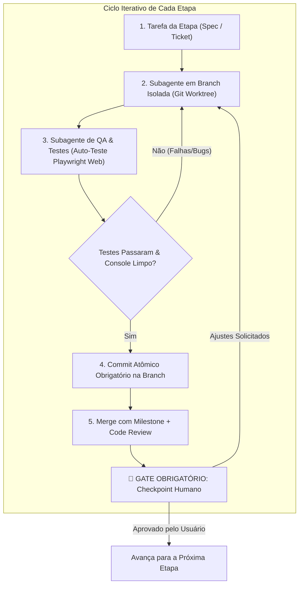
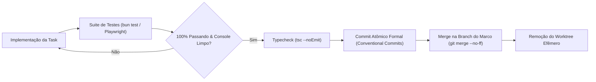

# Plano de Engenharia e Fluxo de Desenvolvimento Autônomo com Vite
## Orquestração Multi-Subagente, Multi-Branches (Git Worktrees), Auto-Teste Web com Playwright, Commits Obrigatórios e Checkpoints Humanos

> **Arquivo:** `/home/eduardorwll/Downloads/plano-fluxo-desenvolvimento-e-testes-vite.md`  
> **Status:** Plano de Engenharia e Governança de Desenvolvimento (Atualização Contínua)  
> **Última Atualização:** 29 de Outubro de 2026 (v1.1)  
> **Local do Repositório do Projeto:** `~/Sandbox/src/insta-auto-panel/`  
> **Diretório de Execução do AGY:** `~/Sandbox/`  
> **Objetivo:** Estabelecer o protocolo rigoroso de desenvolvimento iterativo para o **Social Panel PRO**, permitindo que os agentes desenvolvam em branches isoladas, realizem commits obrigatórios após testes bem-sucedidos, testem a própria interface web de forma autônoma e passem por portais obrigatórios de aprovação com o humano.

---

## 📌 Histórico de Revisões e Registro de Decisões

| Versão | Data | Autor | Resumo das Alterações |
| :---: | :---: | :---: | :--- |
| **v1.0** | 29/10/2026 | AGY & Usuário | Mapeamento inicial: subagentes especializados, auto-teste web com Playwright headless, integração das skills do Sandbox e 5 marcos com checkpoints humanos. |
| **v1.1** | 29/10/2026 | AGY & Usuário | **Governança Git & Multi-Branch com AGY:**<br>1. Localização oficial do repositório fixada em `~/Sandbox/src/insta-auto-panel/` com AGY rodando em `~/Sandbox`.<br>2. Paradigma de **Multi-Branches com Git Worktrees / Workspace 'share'** para trabalho paralelo de subagentes sem conflito de arquivos.<br>3. **Regra Obrigatória de Commits Atômicos:** Todo subagente DEVE commitar cada task finalizada e testada com 100% de êxito antes de qualquer merge.<br>4. Padrão estrito de Conventional Commits e política de gates pré-commit. |

---

## 1. Visão Geral do Protocolo de Desenvolvimento

O desenvolvimento do **Social Panel PRO** (Vite + Bun + React + shadcn/ui + SQLite Drizzle) não será feito de forma monolítica ou desordenada. Ele seguirá uma esteira estrita baseada em:

1. **Paradigma de Subagentes Especializados:** Separação funcional de responsabilidades (Arquiteto, Desenvolvedor Backend, Desenvolvedor Frontend, Agente de QA/Testes e Revisor de Código).
2. **Capacidade de Auto-Teste Web:** O agente de QA tem a capacidade de subir o servidor Vite, abrir o navegador headless via **Playwright**, interagir com botões, preencher formulários, verificar mensagens de toast e inspecionar erros no console do navegador de forma autônoma.
3. **Mapeamento e Invocação das Skills de `~/Sandbox`:** Aplicação prática dos padrões de design de software e arquitetura limpa presentes no repositório de skills do usuário.
4. **Governança Multi-Branch e Commits Atômicos Obrigatórios:** Cada subagente opera em sua própria branch isolada via **Git Worktrees** (`Workspace: 'share'`). Toda task concluída e validada por testes DEVE gerar um commit atômico formal antes do merge.
5. **Gates Obrigatórios de Validação Humana (Human-in-the-Loop):** Ao término de cada etapa/marco (Milestone), o sistema **pausa obrigatoriamente**, apresenta um relatório de evidências de teste e solicita a aprovação do usuário para avançar.



---

## 2. Inventário e Aplicação das Skills Disponíveis em `~/Sandbox`

O repositório em `~/Sandbox/.agents/skills/` contém um acervo avançado de engenharia de software que será ativado em cada fase do ciclo:

| Skill em `~/Sandbox` | Momento de Aplicação no Fluxo | Papel no Projeto Social Panel PRO |
| :--- | :--- | :--- |
| **`clean-architecture`** | Estruturação de Pastas e Módulos | Garantir a separação entre regras de negócio (domínio), casos de uso (serviços de IA e exportação) e infraestrutura (SQLite, Express/Bun, Canva, AutoSocial). |
| **`tdd` (Test-Driven Development)** | Construção dos Serviços de Backend | Escrita prévia de testes unitários em Bun (`bun:test`) para os adaptadores de IA, cálculos de datas da semana e schema do SQLite antes da implementação. |
| **`ui-ux-pro-max` & `ui-styling`** | Construção da Interface Vite/React | Aplicação das melhores práticas de design system, hierarquia visual, contraste de cores (WCAG), micro-interações do shadcn/ui e responsividade fluida. |
| **`code-review` & `clean-code`** | Gate Final de Cada Subtarefa | Verificação estrita de nomes expressivos, funções curtas com responsabilidade única, tipagem TypeScript estrita e eliminação de `any`. |
| **`a-philosophy-of-software-design`** | Design de APIs e Interfaces | Criação de "módulos profundos" (interfaces simples que escondem complexidade pesada, como a interface `AIProvider`). |
| **`diagnosing-bugs`** | Resolução de Falhas em Testes | Protocolo metódico de reprodução de bugs encontrados pelo Playwright sem aplicar correções cegas ou adivinhações. |

### Skills Globais Complementares Ativadas:
* **`to-spec` & `to-tickets`:** Para desmembrar requisitos em cartões atômicos de execução.
* **`design-system`:** Para padronizar os tokens de cores, espaçamentos e componentes do shadcn/ui.

---

## 3. Governança Multi-Branch com Git Worktrees e Commits Obrigatórios via AGY

O desenvolvimento acontecerá com o usuário executando o **AGY (Antigravity)** a partir de **`~/Sandbox/`**, e o repositório local do projeto residindo em:  
📍 **`~/Sandbox/src/insta-auto-panel/`**

### 3.1. Por Que Usar Git Worktrees / Workspace 'share' no AGY?
O maior gargalo em sistemas multiagentes tradicionais é a **colisão de arquivos**: quando o agente de backend e o agente de frontend tentam editar arquivos na mesma pasta de trabalho simultaneamente, ocorrem conflitos de git, arquivos corrompidos e travamentos de lock no banco de dados local.

O AGY resolve isso nativamente através do modo de workspace isolado:
* **`Workspace: 'share'` (Git Worktree):** Cria um diretório de trabalho independente para o subagente, compartilhando o mesmo repositório `.git` raiz sem duplicar armazenamento.
* **Isolamento de Branches:** Cada subagente trabalha em sua própria branch e pasta física efêmera, podendo rodar `bun run dev` e testes sem interferir no workspace do Tech Lead ou de outros subagentes.

### 3.2. Topologia de Branches do Projeto
```
main (Produção estável / Releases aprovadas pelo humano)
  │
  ├── milestone/M1-foundation
  │     ├── feat/M1-T1-bun-sqlite-schema  (Worktree do Subagente Backend)
  │     └── test/M1-T1-unit-tests         (Worktree do Subagente de QA)
  │
  ├── milestone/M2-ui-shadcn
  │     ├── feat/M2-T1-company-switcher   (Worktree do Subagente Frontend)
  │     └── test/M2-T1-playwright-e2e     (Worktree do Subagente de QA)
```

1. **`main`:** Código de produção 100% testado e aprovado pelo usuário humano.
2. **`milestone/M<X>`:** Branch de integração do marco atual.
3. **`feat/<tarefa>` / `test/<tarefa>` / `fix/<tarefa>`:** Branches atômicas e efêmeras onde os subagentes operam isoladamente.

### 3.3. Regra de Ouro: Commits Atômicos Obrigatórios por Task Concluída
Nenhuma tarefa (ticket) pode ser dada como finalizada nem mergeada sem cumprir o **Protocolo Estrito de Commit**:



#### Critérios Inegociáveis Pré-Commit:
1. `bun test` executou e passou com 100% de sucesso.
2. `bun run test:e2e` (Playwright) rodou no navegador headless e validou os seletores e fluxos.
3. `bun x tsc --noEmit` executou sem acusar nenhum erro de tipo TypeScript.
4. Console do navegador sem erros de JavaScript ou exceções não tratadas.

#### Padrão de Mensagem de Commit (Conventional Commits):
Todo commit gerado pelos agentes deve seguir o formato semântico padronizado:
* `feat(db): implementa schema de empresas e fotos com bun:sqlite e drizzle [closes #M1-T1]`
* `test(e2e): adiciona suite playwright para o company switcher e modal de cores [closes #M2-T2]`
* `fix(carousel): ajusta calculo dinamico de lâminas para 8 slides [closes #M3-T4]`
* `refactor(ai): extrai interface abstrata AIProvider para adaptadores agnósticos`

---

## 4. Novas Skills Recomendadas para Turbinar o Fluxo

Para que os agentes consigam **testar a si mesmos no navegador** e elevar o padrão do ambiente Bun/Vite, recomendamos a adição de 3 novas skills especializadas:

### 4.1. Skill `playwright-agent-tester` (Auto-Teste de Interface Web)
* **Objetivo:** Ensina o subagente a instanciar o Playwright para testar aplicações web locais em tempo de desenvolvimento.
* **Regras Estritas:**
  - Uso prioritário de seletores semânticos acessíveis (`getByRole`, `getByLabel`, `getByText`) em vez de classes CSS frágeis.
  - Monitoramento contínuo de eventos de console (`page.on('console', msg => ...)` e `page.on('pageerror', err => ...)`) para reprovar o teste se houver qualquer erro não tratado no React.
  - Captura automatizada de screenshots em caso de falha para evidência.
  - Validação de estados assíncronos via web assertions nativas (`await expect(locator).toBeVisible()`).

### 4.2. Skill `bun-vite-tooling`
* **Objetivo:** Otimização de scripts de build, hot-reload, variáveis de ambiente `.env` e concorrência no runtime do Bun (`Bun.serve()` coexistindo com o proxy de desenvolvimento do Vite).

### 4.3. Skill `hitl-checkpoint-protocol` (Human-in-the-Loop)
* **Objetivo:** Padronização do formato dos relatórios de entrega para o humano, exibindo o que foi feito, os testes que passaram, o link local para visualização e as perguntas específicas de validação antes de avançar.

---

## 5. O Paradigma de Subagentes Especializados

Para evitar sobrecarga de contexto e garantir especialização, o agente orquestrador invocará subagentes específicos conforme a tarefa:

```
┌────────────────────────────────────────────────────────────────────────┐
│                   ORQUESTRADOR PRINCIPAL (TECH LEAD)                   │
│       Coordena o backlog, gerencia as etapas e interage com o Humano   │
└───────────────────────────────────┬────────────────────────────────────┘
                                    │
    ┌───────────────────────────────┼───────────────────────────────┐
    ▼                               ▼                               ▼
┌───────────────────────┐ ┌───────────────────────┐ ┌────────────────────┐
│ SUBAGENTE 1: BACKEND  │ │ SUBAGENTE 2: FRONTEND │ │ SUBAGENTE 3: QA    │
│ Bun, SQLite, Drizzle, │ │ Vite, React, shadcn,  │ │ Playwright Headless│
│ Gemini/OpenAI Adapter │ │ UI/UX Pro Max, Telas  │ │ Auto-Teste & Logs  │
└───────────────────────┘ └───────────────────────┘ └────────────────────┘
```

1. **Subagente Tech Lead / Planner:**
   - Lê as especificações, decompõe os tickets da etapa e confere a integridade da arquitetura.
   - Apresenta os checkpoints ao usuário humano e aguarda a autorização explícita para prosseguir.
2. **Subagente Backend & Database (`bun-engineer`):**
   - Implementa schemas no SQLite via Drizzle ORM, serviços de persistência e endpoints REST locais.
   - Aplica as skills `clean-architecture` e `tdd`.
3. **Subagente Frontend & UI (`vite-ui-engineer`):**
   - Cria componentes no Vite/React utilizando shadcn/ui e Tailwind CSS.
   - Aplica as skills `ui-ux-pro-max` e `ui-styling`.
4. **Subagente de QA & Verificação Autônoma (`playwright-tester`):**
   - Executa `bun run dev`, conecta o Playwright no `http://localhost:5173`, simula cliques reais de usuário, valida formulários e garante que a UI funciona sem erros de JavaScript.
   - Gera o relatório de aprovação técnica.
5. **Subagente de Code Quality & Review (`code-reviewer`):**
   - Roda `tsc --noEmit` para garantir zero erros de tipagem TypeScript.
   - Executa linters e aplica as skills `clean-code` e `code-review`.

---

## 6. Como o Agente Testa a Si Mesmo na Web (Mecanismo Passo a Passo)

Para que o agente verifique a aplicação web sem precisar que o humano clique manualmente a cada mudança, ele utiliza a seguinte rotina automatizada:

```typescript
// Exemplo do script interno executado pelo Subagente de QA
import { chromium, expect } from '@playwright/test';

async function autoTestSocialPanel() {
  const browser = await chromium.launch({ headless: true });
  const context = await browser.newContext();
  const page = await context.newPage();

  // 1. Escuta de Erros no Console
  const consoleErrors: string[] = [];
  page.on('console', msg => {
    if (msg.type() === 'error') consoleErrors.push(msg.text());
  });
  page.on('pageerror', err => consoleErrors.push(err.message));

  // 2. Navegação e Interação
  await page.goto('http://localhost:5173');
  await expect(page.getByRole('heading', { name: /Social Panel/i })).toBeVisible();

  // 3. Teste de Troca de Empresa
  await page.getByRole('combobox', { name: /Empresa/i }).click();
  await page.getByRole('option', { name: /Empresa Alpha/i }).click();

  // 4. Teste do Seletor Dinâmico de Slides (3 a 10)
  const slideStepper = page.getByRole('spinbutton', { name: /Quantidade de Lâminas/i });
  await slideStepper.fill('7');
  await expect(page.locator('.slide-card')).toHaveCount(7);

  // 5. Verificação Final de Integridade
  if (consoleErrors.length > 0) {
    throw new Error(`Falha de Console detectada pelo agente: ${consoleErrors.join(', ')}`);
  }

  await browser.close();
}
```

---

## 7. Roteiro de Etapas com Checkpoints Humanos Obrigatórios

O desenvolvimento é fatiado em **5 Marcos (Milestones)**. Ao final de cada marco, o agente gera as evidências de teste, apresenta um resumo conciso e **solicita a revisão humana**:

### Marco 1: Fundação do Projeto & Banco SQLite Confiável
* **Entregas:**
  - Setup do projeto com Bun + Vite + React 19 + TypeScript.
  - Configuração do SQLite nativo (`bun:sqlite`) com Drizzle ORM.
  - Implementação das tabelas: `companies`, `photo_assets`, `weekly_schedules`, `posts`, `post_slides` e `ai_provider_settings`.
  - Testes unitários com `bun test` validando inserções, consultas e cascateamento.
* **Auto-Teste do Agente:** Roda suite de testes unitários com 100% de aprovação.
* 🚨 **GATE 1 - Checkpoint Humano:** Apresentar o schema validado, demonstrar os testes rodando e solicitar aprovação para avançar para a interface.

---

### Marco 2: Design System, Layout Base & Seletor Multi-Empresa
* **Entregas:**
  - Instalação e configuração do **shadcn/ui** (Tailwind CSS, Radix Primitives e Lucide React).
  - Componente de Topbar com **Company Switcher** (troca dinâmica de empresa ativa).
  - Modal de cadastro e edição de empresas (Cores Hex com Color Picker, WhatsApp, Bio e Canva Template ID).
* **Auto-Teste do Agente:** Subagente Playwright abre a tela, cadastra uma empresa fictícia, seleciona-a no dropdown e confirma se os dados foram salvos no SQLite sem erros no console.
* 🚨 **GATE 2 - Checkpoint Humano:** O usuário abre o link no navegador local, testa a troca de empresas e valida a estética visual antes de passar para o calendário.

---

### Marco 3: Planejador Semanal com Seletor de Slides (3 a 10) e Banco de Fotos
* **Entregas:**
  - Interface do calendário semanal (Segunda a Domingo) com categorização editorial.
  - **Seletor de Quantidade de Slides (3 a 10 lâminas)** com ajuste dinâmico dos cards de conteúdo.
  - Módulo de **Banco de Fotos Base**: upload com Multer/Bun, galeria visual com tags e vinculação de fotos aos posts.
  - Card de **Preview do Slide 1 (Capa 1080x1350)** refletindo em tempo real as cores da marca e a foto escolhida.
* **Auto-Teste do Agente:** Playwright faz upload de imagem de teste, seleciona 8 slides para quarta-feira, associa a foto e valida se o mockup renderizou a proporção 4:5 corretamente.
* 🚨 **GATE 3 - Checkpoint Humano:** O usuário valida a usabilidade da montagem dos posts da semana e a visualização do banco de fotos.

---

### Marco 4: Integração com IA Generativa Agnóstica (Multi-Provedor)
* **Entregas:**
  - Implementação do módulo `AIProvider` em Bun com adaptadores para **Gemini**, **OpenAI**, **Claude**, **Groq** e **Ollama**.
  - Modal de configurações no painel para troca de provedor, input de chave de API e seleção de modelo com botão de *"Testar Conexão"*.
  - Prompt com saídas estruturadas adaptadas dinamicamente ao número de lâminas escolhido e redação de legendas com WhatsApp (`wa.me`).
  - Botão de 1 clique *"Gerar com IA"* no post do dia.
* **Auto-Teste do Agente:** Script executa chamada mock/real, confere se o JSON de 7 lâminas gerado foi validado pelo Zod e se preencheu todos os campos da UI perfeitamente.
* 🚨 **GATE 4 - Checkpoint Humano:** O usuário insere sua chave de API de preferência, clica para gerar um post de teste e valida a qualidade do copywriting dos slides e da legenda.

---

### Marco 5: Exportação para Canva Pro e Fila do AutoSocial
* **Entregas:**
  - Exportador CSV formatado com codificação UTF-8 BOM e escape rigoroso para o **Bulk Create do Canva Pro**.
  - Integração com o filesystem do **`Katzca/AutoSocial`**: botão para despachar a mídia e o arquivo `.description` diretamente para `queue/<account>/instagram/pending/`.
  - Monitoramento visual do status do post (Rascunho $\rightarrow$ Pronto Canva $\rightarrow$ Na Fila $\rightarrow$ Publicado).
* **Auto-Teste do Agente:** O agente aciona a exportação, valida se o arquivo CSV baixado possui as colunas exatas e se os arquivos sidecar foram criados na pasta correta do AutoSocial.
* 🚨 **GATE 5 - Checkpoint Humano:** Teste final integrado. O usuário importa o CSV no Canva, confere a geração em lote e valida o fluxo de agendamento. Conclusão do projeto.

---

## 8. Critérios Inegociáveis de Conclusão de Cada Etapa (Definition of Done)

Para que um marco ou tarefa seja submetido à avaliação do humano, ele deve obrigatoriamente cumprir:

1. **Zero Erros de Tipagem:** `bun x tsc --noEmit` passa sem nenhum erro.
2. **Auto-Teste Playwright Passando:** A rotina do subagente de QA executou o fluxo no navegador headless com 100% de sucesso.
3. **Console Limpo:** Zero erros de JavaScript, warnings de chaves React ou falhas de rede no console do navegador.
4. **Commit Atômico Realizado:** A tarefa foi formalmente commitada na branch isolada seguindo o padrão Conventional Commits com testes atestados.
5. **Relatório de Evidências Pronto:** Resumo detalhado do que foi feito e como testar antes de pedir o "De Acordo" do usuário.

---

> [!IMPORTANT]
> Este documento é o roteiro operacional oficial para a fase de desenvolvimento. Ele assegura total transparência, qualidade contínua de software e controle absoluto nas mãos do usuário humano em todas as etapas.
