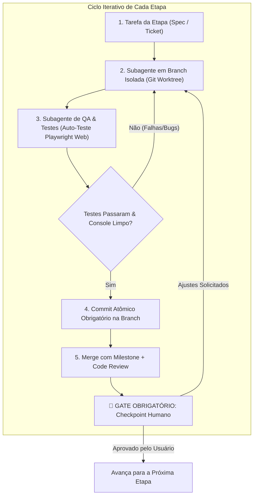
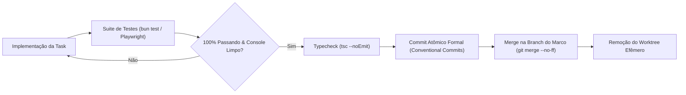

# Plano de Engenharia e Fluxo de Desenvolvimento Autônomo com Vite
## Orquestração Multi-Subagente, Multi-Branches (Git Worktrees), Auto-Teste Web com Playwright, Commits Obrigatórios e Checkpoints Humanos

> **Arquivo:** `/home/eduardorwll/Sandbox/src/insta-auto-panel/plano-fluxo-desenvolvimento-e-testes-vite.md`  
> **Status:** Plano de Engenharia e Governança de Desenvolvimento (Atualização Contínua)  
> **Última Atualização:** 29 de Outubro de 2026 (v1.3)  
> **Local do Repositório do Projeto:** `~/Sandbox/src/insta-auto-panel/`  
> **Diretório de Execução do AGY:** `~/Sandbox/`  
> **Objetivo:** Estabelecer o protocolo rigoroso de desenvolvimento iterativo para o **Social Panel PRO**, operando com os **4 Pilares Mandatórios de Economia de Tokens (`graphify`, `graft`/`prowl`, `caveman` Input-Only + `cavecrew`, e `delegate-skills` com fallback e lanes em `gemini-3.8-flash-high` / `effort: "high"`)**, a **Tríade Mandatória de UI, Design Engineering & Craft Visual (`taste-skill`, `emilkowalski/skills`, `impeccable`)**, diagrama único interativo via **`archify`** (`docs/architecture.html`), multi-branches isoladas, auto-teste Playwright headless e o **Marco 6 (M6): Studio Visual Autônomo Sem Canva (`OpenDesign` + `Variable Image AI Adapter`)**.

---

## 📌 Histórico de Revisões e Registro de Decisões

| Versão | Data | Autor | Resumo das Alterações |
| :---: | :---: | :---: | :--- |
| **v1.0** | 29/10/2026 | AGY & Usuário | Mapeamento inicial: subagentes especializados, auto-teste web com Playwright headless, integração das skills do Sandbox e 5 marcos com checkpoints humanos. |
| **v1.1** | 29/10/2026 | AGY & Usuário | **Governança Git & Multi-Branch com AGY:**<br>1. Localização oficial do repositório fixada em `~/Sandbox/src/insta-auto-panel/` com AGY rodando em `~/Sandbox`.<br>2. Paradigma de **Multi-Branches com Git Worktrees / Workspace 'share'** para trabalho paralelo de subagentes sem conflito de arquivos.<br>3. **Regra Obrigatória de Commits Atômicos:** Todo subagente DEVE commitar cada task finalizada e testada com 100% de êxito antes de qualquer merge.<br>4. Padrão estrito de Conventional Commits e política de gates pré-commit. |
| **v1.2** | 29/10/2026 | AGY & Usuário | **4 Token Savers Mandatórios, Archify Single Diagram & Marco 6 (Zero Canva):**<br>1. Integração obrigatória em todo o Sandbox e no projeto dos 4 motores de economia de tokens: **`graphify`** (Macro AST), **`graft` + `prowl`** (Micro Context), **`caveman`** (`caveman-compress` / `shrink-log` para **entrada** + `cavecrew` para retorno compacto de subagentes, mantendo a **saída** no Relatório Padrão) e **`delegate-skills`**.<br>2. Manutenção de diagrama único interativo com **`archify`** (`docs/architecture.html` servido em `/architecture`).<br>3. Adição do **Marco 6 (M6):** Studio Visual Autônomo Sem Canva combinando o motor de Templates 4:5 inspirado em `clawnify/OpenDesign` com `Variable Image AI Adapter`. |
| **v1.3** | 29/10/2026 | AGY & Usuário | **Tríade de UI/Design Craft (`taste-skill`, `emilkowalski/skills`, `impeccable`) & Fallback de Delegação em Flash Max Effort:**<br>1. Instalação global em `~/Sandbox/.agents/skills/` e integração obrigatória no fluxo de desenvolvimento de: **`Leonxlnx/taste-skill`** (`design-taste-frontend` com `draw.mjs --app`, `lint.mjs`, `inspect.mjs --app`), **`emilkowalski/skills`** (`emil-design-eng`, `animate`, `review-animations`, `improve-animations`, `animation-performance`, `break-ui`, `mobile-native`) e **`pbakaus/impeccable`** (`v4.8.0` — modos **Operate** e **Persuade**, comandos `shape`, `critique`, `audit`, `polish`, `harden`).<br>2. Configuração de `.delegate/config.json` e `delegate-lanes.json` com **fallback e lanes padronizadas no modelo `gemini-3.8-flash-high` com esforço máximo (`"effort": "high"`)**. |

---

## 1. Visão Geral do Protocolo de Desenvolvimento

O desenvolvimento do **Social Panel PRO** (Vite + Bun + React + shadcn/ui + SQLite Drizzle) não será feito de forma monolítica ou desordenada. Ele seguirá uma esteira estrita baseada em:

1. **Paradigma de Subagentes Especializados:** Separação funcional de responsabilidades (Arquiteto, Desenvolvedor Backend, Desenvolvedor Frontend, Agente de QA/Testes e Revisor de Código).
2. **Capacidade de Auto-Teste Web:** O agente de QA tem a capacidade de subir o servidor Vite, abrir o navegador headless via **Playwright**, interagir com botões, preencher formulários, verificar mensagens de toast e inspecionar erros no console do navegador de forma autônoma.
3. **Mapeamento e Invocação das Skills de `~/Sandbox`:** Aplicação prática dos padrões de design de software e arquitetura limpa presentes no repositório de skills do usuário.
4. **Governança Multi-Branch e Commits Atômicos Obrigatórios:** Cada subagente opera em sua própria branch isolada via **Git Worktrees** (`Workspace: 'share'`). Toda task concluída e validada por testes DEVE gerar um commit atômico formal antes do merge.
5. **Gates Obrigatórios de Validação Humana (Human-in-the-Loop):** Ao término de cada etapa/marco (Milestone), o sistema **pausa obrigatoriamente**, apresenta um relatório de evidências de teste e solicita a aprovação do usuário para avançar.



---

## 2. Inventário e Aplicação das Skills Disponíveis em `~/Sandbox`

O repositório em `~/Sandbox/.agents/skills/` contém um acervo avançado de engenharia de software que será ativado em cada fase do ciclo:

| Skill em `~/Sandbox` | Momento de Aplicação no Fluxo | Papel no Projeto Social Panel PRO |
| :--- | :--- | :--- |
| **`clean-architecture`** | Estruturação de Pastas e Módulos | Garantir a separação entre regras de negócio (domínio), casos de uso (serviços de IA e exportação) e infraestrutura (SQLite, Express/Bun, Canva, AutoSocial). |
| **`tdd` (Test-Driven Development)** | Construção dos Serviços de Backend | Escrita prévia de testes unitários em Bun (`bun:test`) para os adaptadores de IA, cálculos de datas da semana e schema do SQLite antes da implementação. |
| **`ui-ux-pro-max` & `ui-styling`** | Construção da Interface Vite/React | Aplicação das melhores práticas de design system, hierarquia visual, contraste de cores (WCAG), micro-interações do shadcn/ui e responsividade fluida. |
| **`code-review` & `clean-code`** | Gate Final de Cada Subtarefa | Verificação estrita de nomes expressivos, funções curtas com responsabilidade única, tipagem TypeScript estrita e eliminação de `any`. |
| **`a-philosophy-of-software-design`** | Design de APIs e Interfaces | Criação de "módulos profundos" (interfaces simples que escondem complexidade pesada, como a interface `AIProvider` e `ImageProvider`). |
| **`diagnosing-bugs`** | Resolução de Falhas em Testes | Protocolo metódico de reprodução de bugs encontrados pelo Playwright sem aplicar correções cegas ou adivinhações. |
| **`graphify`** | Contexto Macro AST (`graphify-out/`) | Mapeamento arquitetural e travessia BFS de grafos (`16.6x` menos tokens por consulta) + Git hooks automáticos. |
| **`graft` + `prowl`** | Contexto Micro Cirúrgico (`graft/`) | Extração de APIs (`graft skeleton`), *blast radius* (`graft callers`) e busca semântica (`97%` de redução / `31.6x` mais leve). |
| **`caveman` (`caveman-compress` + `cavecrew`)** | Compressão de **Entrada** (Input-Only) | Comprime *briefs*, docs de contexto e logs (`caveman compress` / `shrink-log`) e força subagentes a responderem em formato compacto `cavecrew`, preservando a **saída ao usuário** no Relatório Padrão completo. |
| **`delegate-skills` (`delegate-setup` + `agy-delegate`)** | Orquestração Multi-Lane (`.delegate/config.json`) | Descarrega tarefas nas lanes `default`, `fallback`, `fast`, `tests`, `feature`, `ui` e `review` padronizadas com **`gemini-3.8-flash-high` (`effort: "high"`)**. |
| **`taste-skill` (`design-taste-frontend`)** | Direção de Arte & Anti-Slop Frontend | Aplica blueprint visual (`draw.mjs --app`), lint estático anti-slop (`lint.mjs`) e inspeção real multi-viewport (`inspect.mjs --app` em `1440px`, `768px`, `390px`), garantindo hierarquia por luminância e densidade real. |
| **`emilkowalski/skills` (`emil-design-eng`, `animate`, `review-animations`, `break-ui`)** | Micro-Interações, Física de UI & Stress-Testing | Aplica feedback tátil imediato (`scale(0.97)` em `:active`), proíbe `scale(0)` (usa `scale(0.95)` + `opacity: 0`), curvas `ease-out` customizadas (`cubic-bezier(0.23, 1, 0.32, 1)`) `< 300ms`, GPU `transform`/`opacity`, `tabular-nums` e teste de quebra com inputs extremos (`break-ui`). |
| **`impeccable` (`pbakaus/impeccable` v4.8.0)** | Modos de Superfície (`Operate` / `Persuade`) & Polimento | Separa o design do Studio de Operação (modo **Operate**) do design das lâminas 4:5 de carrossel (modo **Persuade**), aplicando o pipeline `shape` -> `layout`/`typeset`/`colorize` -> `critique`/`audit` -> `polish`/`harden`. |
| **`archify`** | Diagrama Único de Arquitetura (`docs/architecture.html`) | Mantém um único diagrama interativo auditado por gates (`validate`, `deliver`, `check`, `browser-check`) acessível em `/architecture`. |

### Skills Globais Complementares Ativadas:
* **`to-spec` & `to-tickets`:** Para desmembrar requisitos em cartões atômicos de execução.
* **`design-system`:** Para padronizar os tokens de cores, espaçamentos e componentes do shadcn/ui.

---

## 3. Governança Multi-Branch com Git Worktrees e Commits Obrigatórios via AGY

O desenvolvimento acontecerá com o usuário executando o **AGY (Antigravity)** a partir de **`~/Sandbox/`**, e o repositório local do projeto residindo em:  
📍 **`~/Sandbox/src/insta-auto-panel/`**

### 3.1. Por Que Usar Git Worktrees / Workspace 'share' no AGY?
O maior gargalo em sistemas multiagentes tradicionais é a **colisão de arquivos**: quando o agente de backend e o agente de frontend tentam editar arquivos na mesma pasta de trabalho simultaneamente, ocorrem conflitos de git, arquivos corrompidos e travamentos de lock no banco de dados local.

O AGY resolve isso nativamente através do modo de workspace isolado:
* **`Workspace: 'share'` (Git Worktree):** Cria um diretório de trabalho independente para o subagente, compartilhando o mesmo repositório `.git` raiz sem duplicar armazenamento.
* **Isolamento de Branches:** Cada subagente trabalha em sua própria branch e pasta física efêmera, podendo rodar `bun run dev` e testes sem interferir no workspace do Tech Lead ou de outros subagentes.

### 3.2. Topologia de Branches do Projeto
```
main (Produção estável / Releases aprovadas pelo humano)
  │
  ├── milestone/M1-foundation
  │     ├── feat/M1-T1-bun-sqlite-schema  (Worktree do Subagente Backend)
  │     └── test/M1-T1-unit-tests         (Worktree do Subagente de QA)
  │
  ├── milestone/M2-ui-shadcn
  │     ├── feat/M2-T1-company-switcher   (Worktree do Subagente Frontend)
  │     └── test/M2-T1-playwright-e2e     (Worktree do Subagente de QA)
```

1. **`main`:** Código de produção 100% testado e aprovado pelo usuário humano.
2. **`milestone/M<X>`:** Branch de integração do marco atual.
3. **`feat/<tarefa>` / `test/<tarefa>` / `fix/<tarefa>`:** Branches atômicas e efêmeras onde os subagentes operam isoladamente.

### 3.3. Regra de Ouro: Commits Atômicos Obrigatórios por Task Concluída
Nenhuma tarefa (ticket) pode ser dada como finalizada nem mergeada sem cumprir o **Protocolo Estrito de Commit**:



#### Critérios Inegociáveis Pré-Commit:
1. `bun test` executou e passou com 100% de sucesso.
2. `bun run test:e2e` (Playwright) rodou no navegador headless e validou os seletores e fluxos.
3. `bun x tsc --noEmit` executou sem acusar nenhum erro de tipo TypeScript.
4. Console do navegador sem erros de JavaScript ou exceções não tratadas.

#### Padrão de Mensagem de Commit (Conventional Commits):
Todo commit gerado pelos agentes deve seguir o formato semântico padronizado:
* `feat(db): implementa schema de empresas e fotos com bun:sqlite e drizzle [closes #M1-T1]`
* `test(e2e): adiciona suite playwright para o company switcher e modal de cores [closes #M2-T2]`
* `fix(carousel): ajusta calculo dinamico de lâminas para 8 slides [closes #M3-T4]`
* `refactor(ai): extrai interface abstrata AIProvider para adaptadores agnósticos`

---

## 4. A Tríade Mandatória de UI, Design Engineering & Craft Visual + Auto-Teste

Além de auto-teste no navegador e otimização Bun/Vite, todas as tarefas visuais e de interface do **Social Panel PRO** seguem obrigatoriamente a **Tríade de UI Craft** instalada globalmente em `~/Sandbox/.agents/skills/`:

### 4.1. Direção de Arte & Inspeção Anti-Slop (`Leonxlnx/taste-skill` — `design-taste-frontend`)
* **Objetivo:** Eliminar estética genérica de IA ("AI slop"), excesso de bordas 1px desnecessárias e gradientes decorativos sem função, impondo hierarquia por luminância (`surface-0` $\rightarrow$ `surface-1` $\rightarrow$ `surface-2`) e densidade de dados reais.
* **Pipeline Obrigatório para Telas de App (`--app`):**
  1. **Blueprint (`draw.mjs --app`):** Geração do mapa estrutural da tela antes de escrever JSX pesado.
  2. **Lint Estático (`lint.mjs`):** Verificação automática contra anti-padrões visuais e de layout.
  3. **Inspeção Multi-Viewport (`inspect.mjs <url> --app`):** Auditoria em navegador real nas três larguras canônicas (`1440px`, `768px`, `390px`).

### 4.2. Design Engineering, Micro-Interações e Stress-Testing (`emilkowalski/skills`)
* **Objetivo:** Aplicar as leis físicas e de interação de Emil Kowalski (`emil-design-eng`, `animate`, `review-animations`, `improve-animations`, `animation-performance`, `break-ui`, `mobile-native`).
* **Regras Inegociáveis de Interação:**
  - **Feedback Tátil Imediato:** Todo botão interativo deve responder com `transform: scale(0.97)` em `:active`.
  - **Proibido `scale(0)`:** Elementos nunca entram a partir de `scale(0)`; toda entrada de modal/popover/card parte de `scale(0.95)` + `opacity: 0`.
  - **Curvas `ease-out` Customizadas e Rápidas:** Transições de UI usam `cubic-bezier(0.23, 1, 0.32, 1)` com duração `< 300ms` (`150ms–220ms` para micro-interações) e nunca animam ações repetidas centenas de vezes por dia ou atalhos de teclado.
  - **Performance GPU & Tipografia Numérica:** Animações restritas a `transform` e `opacity`; contadores, preços, dimensões (`1080×1350`) e contagens de slides usam obrigatoriamente `font-variant-numeric: tabular-nums`.
  - **Teste de Quebra (`break-ui`):** Simulação de estados extremos (headlines longas de 300 caracteres, listas vazias, cliques rápidos repetidos e desconexão de API).

### 4.3. Modos de Superfície e Polimento Sistêmico (`pbakaus/impeccable` v4.8.0)
* **Objetivo:** Governar o design por intenção de superfície antes da implementação:
  - **Modo `Operate`** (Painel Social Panel PRO, `WeekPlanner`, `DesignStudioModal`, `PublicationQueue`): Prioriza densidade operacional, clareza de estado, atalhos rápidos e zero distração visual.
  - **Modo `Persuade`** (Templates 4:5 exportados pelo motor `OpenDesign`): Prioriza impacto tipográfico, ponto focal único, contraste editorial e ritmo narrativo entre os slides `1..N`.
  - **Modo `Read`** (Documentação e `/architecture`): Prioriza medida de linha (`60–75ch`) e escaneabilidade.
* **Sequência Impeccable:** `shape` (UX/superfície) $\rightarrow$ `layout` / `typeset` / `colorize` $\rightarrow$ `critique` / `audit` $\rightarrow$ `polish` / `harden`.

### 4.4. Auto-Teste Web (`playwright-agent-tester`) & `hitl-checkpoint-protocol`
* **Seletores Semânticos & Console Limpo:** Uso prioritário de `getByRole`, `getByLabel`, `getByText` e monitoramento estrito de `page.on('console')` e `page.on('pageerror')`.
* **Checkpoints Humanos (HITL):** Relatórios estruturados completos para o usuário humano com telemetria dos 4 motores de economia de tokens (`bun run tokens:report`).

---

## 5. O Paradigma de Subagentes Especializados e Lanes `delegate-skills` (`gemini-3.8-flash-high`)

Para evitar sobrecarga de contexto e garantir máxima eficiência de quota, o agente orquestrador despacha tarefas para subagentes `cavecrew` e lanes do `.delegate/config.json`, onde **todas as lanes e o fallback utilizam o modelo `gemini-3.8-flash-high` com esforço máximo (`"effort": "high"`)**:

```
┌────────────────────────────────────────────────────────────────────────┐
│                   ORQUESTRADOR PRINCIPAL (TECH LEAD)                   │
│   Comprime entradas (caveman), orquestra lanes (gemini-3.8-flash-high) │
└───────────────────────────────────┬────────────────────────────────────┘
                                    │
    ┌───────────────────────────────┼───────────────────────────────┐
    ▼                               ▼                               ▼
┌───────────────────────┐ ┌───────────────────────┐ ┌────────────────────┐
│ LANE FEATURE / TESTS  │ │ LANE UI (CRAFT TRIAD) │ │ LANE REVIEW / QA   │
│ Bun, SQLite, Drizzle, │ │ taste-skill + emil +  │ │ Playwright Headless│
│ AI & Image Adapters   │ │ impeccable + React 19 │ │ Spec + Standards   │
└───────────────────────┘ └───────────────────────┘ └────────────────────┘
```

1. **Subagente Tech Lead / Planner:**
   - Lê as especificações, comprime *briefs* com `bun run caveman compress`, decompõe os tickets da etapa e confere a integridade da arquitetura via `graphify` e `graft`.
2. **Subagente Researcher (`Lane fast` — `gemini-3.8-flash-high`, `effort: "high"`, `readOnly: true`):**
   - Explora o grafo AST (`graphify`) e esqueletos (`graft skeleton` / `callers`), retornando exclusivamente em formato compacto `cavecrew-investigator`.
3. **Subagente Backend & Database (`Lanes tests / feature` — `gemini-3.8-flash-high`, `effort: "high"`):**
   - Implementa schemas no SQLite via Drizzle ORM, serviços de persistência e adaptadores (`AIProvider`, `ImageProviderAdapter`) seguindo `tdd` e `clean-architecture`, retornando em `cavecrew-builder`.
4. **Subagente Frontend & UI Craft (`Lane ui` — `gemini-3.8-flash-high`, `effort: "high"`):**
   - Cria e refina componentes React 19/Tailwind aplicando obrigatoriamente a **Tríade de UI Craft** (`taste-skill`, `emil-design-eng` + `break-ui`, e `impeccable` nos modos **Operate** e **Persuade**).
5. **Subagente de QA & Code Review (`Lane review` — `gemini-3.8-flash-high`, `effort: "high"`, `readOnly: true`):**
   - Executa `bun run verify:cycle`, Playwright headless (`bun run test:e2e`), auditoria de animações (`review-animations`) e revisão dupla independente (`Spec Match` + `Standards & Quality`), retornando em `cavecrew-reviewer`.
6. **Lane `fallback` (`gemini-3.8-flash-high`, `effort: "high"`, `timeout: "25m"`):**
   - Garante resiliência automática com o modelo Flash em esforço máximo caso qualquer lane especializada sofra timeout ou contenção.

---

## 6. Como o Agente Testa a Si Mesmo na Web (Mecanismo Passo a Passo)

Para que o agente verifique a aplicação web sem precisar que o humano clique manualmente a cada mudança, ele utiliza a seguinte rotina automatizada:

```typescript
// Exemplo do script interno executado pelo Subagente de QA
import { chromium, expect } from '@playwright/test';

async function autoTestSocialPanel() {
  const browser = await chromium.launch({ headless: true });
  const context = await browser.newContext();
  const page = await context.newPage();

  // 1. Escuta de Erros no Console
  const consoleErrors: string[] = [];
  page.on('console', msg => {
    if (msg.type() === 'error') consoleErrors.push(msg.text());
  });
  page.on('pageerror', err => consoleErrors.push(err.message));

  // 2. Navegação e Interação
  await page.goto('http://localhost:5173');
  await expect(page.getByRole('heading', { name: /Social Panel/i })).toBeVisible();

  // 3. Teste de Troca de Empresa
  await page.getByRole('combobox', { name: /Empresa/i }).click();
  await page.getByRole('option', { name: /Empresa Alpha/i }).click();

  // 4. Teste do Seletor Dinâmico de Slides (3 a 10)
  const slideStepper = page.getByRole('spinbutton', { name: /Quantidade de Lâminas/i });
  await slideStepper.fill('7');
  await expect(page.locator('.slide-card')).toHaveCount(7);

  // 5. Verificação Final de Integridade
  if (consoleErrors.length > 0) {
    throw new Error(`Falha de Console detectada pelo agente: ${consoleErrors.join(', ')}`);
  }

  await browser.close();
}
```

---

## 7. Roteiro de Etapas com Checkpoints Humanos Obrigatórios

O desenvolvimento é fatiado em **5 Marcos (Milestones)**. Ao final de cada marco, o agente gera as evidências de teste, apresenta um resumo conciso e **solicita a revisão humana**:

### Marco 1: Fundação do Projeto & Banco SQLite Confiável
* **Entregas:**
  - Setup do projeto com Bun + Vite + React 19 + TypeScript.
  - Configuração do SQLite nativo (`bun:sqlite`) com Drizzle ORM.
  - Implementação das tabelas: `companies`, `photo_assets`, `weekly_schedules`, `posts`, `post_slides` e `ai_provider_settings`.
  - Testes unitários com `bun test` validando inserções, consultas e cascateamento.
* **Auto-Teste do Agente:** Roda suite de testes unitários com 100% de aprovação.
* 🚨 **GATE 1 - Checkpoint Humano:** Apresentar o schema validado, demonstrar os testes rodando e solicitar aprovação para avançar para a interface.

---

### Marco 2: Design System, Layout Base & Seletor Multi-Empresa
* **Entregas:**
  - Instalação e configuração do **shadcn/ui** (Tailwind CSS, Radix Primitives e Lucide React).
  - Componente de Topbar com **Company Switcher** (troca dinâmica de empresa ativa).
  - Modal de cadastro e edição de empresas (Cores Hex com Color Picker, WhatsApp, Bio e Canva Template ID).
* **Auto-Teste do Agente:** Subagente Playwright abre a tela, cadastra uma empresa fictícia, seleciona-a no dropdown e confirma se os dados foram salvos no SQLite sem erros no console.
* 🚨 **GATE 2 - Checkpoint Humano:** O usuário abre o link no navegador local, testa a troca de empresas e valida a estética visual antes de passar para o calendário.

---

### Marco 3: Planejador Semanal com Seletor de Slides (3 a 10) e Banco de Fotos
* **Entregas:**
  - Interface do calendário semanal (Segunda a Domingo) com categorização editorial.
  - **Seletor de Quantidade de Slides (3 a 10 lâminas)** com ajuste dinâmico dos cards de conteúdo.
  - Módulo de **Banco de Fotos Base**: upload com Multer/Bun, galeria visual com tags e vinculação de fotos aos posts.
  - Card de **Preview do Slide 1 (Capa 1080x1350)** refletindo em tempo real as cores da marca e a foto escolhida.
* **Auto-Teste do Agente:** Playwright faz upload de imagem de teste, seleciona 8 slides para quarta-feira, associa a foto e valida se o mockup renderizou a proporção 4:5 corretamente.
* 🚨 **GATE 3 - Checkpoint Humano:** O usuário valida a usabilidade da montagem dos posts da semana e a visualização do banco de fotos.

---

### Marco 4: Integração com IA Generativa Agnóstica (Multi-Provedor)
* **Entregas:**
  - Implementação do módulo `AIProvider` em Bun com adaptadores para **Gemini**, **OpenAI**, **Claude**, **Groq** e **Ollama**.
  - Modal de configurações no painel para troca de provedor, input de chave de API e seleção de modelo com botão de *"Testar Conexão"*.
  - Prompt com saídas estruturadas adaptadas dinamicamente ao número de lâminas escolhido e redação de legendas com WhatsApp (`wa.me`).
  - Botão de 1 clique *"Gerar com IA"* no post do dia.
* **Auto-Teste do Agente:** Script executa chamada mock/real, confere se o JSON de 7 lâminas gerado foi validado pelo Zod e se preencheu todos os campos da UI perfeitamente.
* 🚨 **GATE 4 - Checkpoint Humano:** O usuário insere sua chave de API de preferência, clica para gerar um post de teste e valida a qualidade do copywriting dos slides e da legenda.

---

### Marco 5: Exportação para Canva Pro e Fila do AutoSocial
* **Entregas:**
  - Exportador CSV formatado com codificação UTF-8 BOM e escape rigoroso para o **Bulk Create do Canva Pro**.
  - Integração com o filesystem do **`Katzca/AutoSocial`**: botão para despachar a mídia e o arquivo `.description` diretamente para `queue/<account>/instagram/pending/`.
  - Monitoramento visual do status do post (Rascunho $\rightarrow$ Pronto Canva $\rightarrow$ Na Fila $\rightarrow$ Publicado).
* **Auto-Teste do Agente:** O agente aciona a exportação, valida se o arquivo CSV baixado possui as colunas exatas e se os arquivos sidecar foram criados na pasta correta do AutoSocial.
* 🚨 **GATE 5 - Checkpoint Humano:** Teste final integrado. O usuário importa o CSV no Canva, confere a geração em lote e valida o fluxo de agendamento. (**Concluído e aprovado na `main`**).

---

### Marco 6 (M6): Studio Visual Autônomo Sem Canva (`OpenDesign` Template Engine + `Variable Image AI Adapter`)
* **Motivação & Arquitetura:** Eliminar a dependência manual do Canva Pro integrando diretamente no portal um motor de **Templates Determinísticos 4:5 (1080×1350px 2x Retina)** inspirado no **`clawnify/OpenDesign`** (`Template Fields API`: `headline`, `bodyText`, `cta`, `brandKit`, `background`) combinado com um **`ImageProviderAdapter` Agnóstico** de melhor custo-benefício.
* **Provedores de Imagem Variáveis Suportados (`ImageProviderAdapter`):**
  1. **`pollinations` (Custo $0.00 / Zero-Key):** Geração instantânea de imagens para testes e fundos conceituais sem necessidade de chave.
  2. **`fal-flux` / `openrouter-image` (Ultra Baixo Custo ~$0.003/img):** Modelo `FLUX.1-schnell` / `FLUX.1.1-pro` via API compatível.
  3. **`gemini-imagen` / `openai-image`:** Google Imagen 3 (`gemini-2.5-flash-image`) e OpenAI (`gpt-image-1` / `dall-e-3`).
  4. **`comfyui-local` (Custo $0.00 Local — Motor do Krita AI Diffusion):** Conexão direta com servidor local `http://localhost:8188` (ComfyUI / Stable Diffusion) sem precisar abrir o Krita Desktop.
* **Decomposição Atômica e Lanes de Execução (`delegate-skills` em `gemini-3.8-flash-high` + `caveman` + `graft` + Tríade de UI Craft):**
  - **`M6-T1` (Lane `tests` + `feature` — `gemini-3.8-flash-high`, `effort: "high"`):** Schema (`renderedImageUrl`, `templateId`, `imagePrompt` em `post_slides` + configurações de provedor de imagem) e `ImageProviderAdapter` Agnóstico com testes TDD (`tests/server/image-providers.test.ts`).
  - **`M6-T2` (Lane `feature` — `gemini-3.8-flash-high`, `effort: "high"`):** Motor de Templates 4:5 (`OpenDesign` Template Fields Engine) e endpoint `POST /api/design/render-post` + geração de backgrounds com IA (`POST /api/design/generate-background`), salvando PNGs reais em `data/renders/<companyId>/<postId>/` e integrando direto com `enqueuePostForAutoSocial`.
  - **`M6-T3` (Lane `ui` — `gemini-3.8-flash-high`, `effort: "high"` + Tríade de UI Craft):** Componente `DesignStudioModal.tsx` integrado ao `WeekPlanner` e `PublicationQueue`, projetado com:
    1. **`impeccable` (`shape` + `polish` + `harden`):** Modo **Operate** para os controles do Studio e Modo **Persuade** para os 4 Templates Visuais (`Modern Bold`, `Editorial Clean`, `Dark Neon`, `Split Photo`).
    2. **`taste-skill` (`draw.mjs --app` + `lint.mjs`):** Hierarquia por luminância (`surface-0..2`), densidade real e zero "AI slop".
    3. **`emil-design-eng` (`animate` + `animation-performance` + `break-ui`):** Botões com `:active { transform: scale(0.97) }`, entrada do modal em `scale(0.95)` $\rightarrow$ `scale(1)` com `cubic-bezier(0.23, 1, 0.32, 1)` (`180ms`), `tabular-nums` em dimensões (`1080×1350`) e contadores de lâminas, renderizador Canvas HTML5 de alta definição e botão *"Renderizar Carrossel & Enviar para Fila AutoSocial (Sem Canva)"*.
  - **`M6-T4` (Lane `tests` + `review` — `gemini-3.8-flash-high`, `effort: "high"`):** Teste E2E Playwright (`tests/e2e/design-studio.spec.ts`) validando renderização de carrossel, stress-test de inputs (`break-ui`) e envio direto para a fila sem erros de console; inspeção `taste-skill` (`lint.mjs` / `inspect.mjs --app`); auditoria paralela em 2 eixos (`Standards` + `Spec`) com retorno `cavecrew`; e atualização do diagrama único `Archify` (`docs/architecture.html`).
* 🚨 **GATE 6 - Checkpoint Humano:** O usuário abre o **Design Studio** no portal, escolhe um template visual, gera/renderiza as lâminas 4:5 e despacha diretamente para a fila do AutoSocial sem abrir o Canva.

---

## 8. Critérios Inegociáveis de Conclusão de Cada Etapa (Definition of Done)

Para que um marco ou tarefa seja submetido à avaliação do humano, ele deve obrigatoriamente cumprir:

1. **Zero Erros de Tipagem e Zero `any`:** `bun x tsc --noEmit` passa sem nenhum erro.
2. **Suíte Unitária e E2E Playwright Passando:** `bun test` e `bun run test:e2e` com 100% de sucesso e **0 erros de console**.
3. **Conformidade com a Tríade de UI Craft (quando houver UI/Frontend):** `taste-skill` (`lint.mjs`), `emil-design-eng` (`scale(0.97)` active, sem `scale(0)`, `<300ms` custom `ease-out`, `tabular-nums`, `break-ui`) e `impeccable` (`Operate`/`Persuade` polish & harden).
4. **Sincronização de Grafos e Diagrama Único (`Archify`):** `bun run verify:cycle` e `bun run archify` executados e verdes (`docs/architecture.html` atualizado).
5. **Commit Atômico Realizado:** A tarefa foi formalmente commitada seguindo o padrão Conventional Commits.
6. **Relatório de Evidências + Telemetria Obrigatória dos 4 Token Savers (`bun run tokens:report`):** Todo relatório de fim de tarefa deve exibir explicitamente os tokens economizados por cada ferramenta:
   - `🌱 graft + prowl saved ~N tokens`
   - `🕸️ graphify AST saved ~M tokens`
   - `🪨 caveman (input compression & cavecrew) saved ~K tokens`
   - `🤝 delegate-skills (gemini-3.8-flash-high, effort: high) offloaded ~L tokens`

---

> [!IMPORTANT]
> Este documento é o roteiro operacional oficial para a fase de desenvolvimento. Ele assegura total transparência, qualidade contínua de software e controle absoluto nas mãos do usuário humano em todas as etapas.
