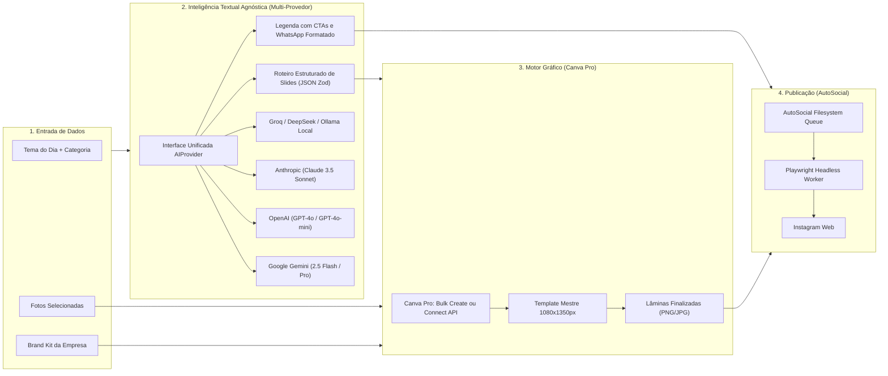

# Documento de Requisitos e Planejamento: Sistema de Automação de Conteúdo no Instagram
## Arquitetura Multi-Conta com Vite, Bun, shadcn/ui, Google Gemini, Canva Pro e AutoSocial

> **Arquivo:** `/home/eduardorwll/Downloads/requisitos-planejamento-automacao-instagram.md`  
> **Status:** Documento Vivo de Planejamento (Atualização Contínua)  
> **Última Atualização:** 29 de Outubro de 2026  
> **Destinatário:** Usuário (Conta Canva Pro ativa)

---

## 📌 Histórico de Revisões e Registro de Decisões

| Versão | Data | Autor | Resumo das Alterações |
| :---: | :---: | :---: | :--- |
| **v1.0** | 29/10/2026 | AGY & Usuário | Mapeamento inicial: descarte da API da Meta, inclusão do Canva Pro como motor gráfico, requisitos do painel open-source (banco de fotos, selecionador semanal dia a dia, cores, contatos e legendas). |
| **v2.0** | 29/10/2026 | AGY & Usuário | **Evolução Arquitetural Completa:**<br>1. Investigação profunda e adoção do **`Katzca/AutoSocial`** como backbone de automação e filas com Playwright.<br>2. Definição da stack do painel: **Vite + Bun + shadcn/ui** com banco confiável **SQLite ACID (`bun:sqlite` / Drizzle ORM)**.<br>3. Suporte nativo a **Múltiplas Contas / Empresas (Multi-Tenant)**.<br>4. Divisão de papéis de IA: **Google Gemini API** para copywriting e roteirização; **Canva Pro** para painéis visuais.<br>5. Mapeamento detalhado do fluxo de dados e schema de banco de dados. |
| **v2.1** | 29/10/2026 | AGY & Usuário | **Parâmetro Dinâmico de Slides do Carrossel:** Definição explícita do número de lâminas como **variável selecionável por post** (de 3 a 10 slides), adaptando dinamicamente o prompt do Gemini, a interface de edição e o banco de dados. |
| **v2.2** | 29/10/2026 | AGY & Usuário | **IA Generativa Agnóstica (Multi-Provedor):** Desacoplamento do Gemini e criação do módulo multi-provedor configurável no painel (Google Gemini, OpenAI, Anthropic Claude, Groq, DeepSeek, OpenRouter, Ollama Local). Suporte a chaves de API globais ou por empresa e saídas estruturadas com validação Zod. |

---

## 1. Visão Geral e Filosofia do Sistema

O projeto consiste em uma plataforma de **criação, governança editorial e publicação autônoma no Instagram**, desenhada para operar com alto nível profissional, estabilidade e zero dependência de aprovações burocráticas da Meta.

A solução é sustentada por três pilares complementares:

```
┌──────────────────────────────────────────────────────────────────────────────────┐
│                   1. PAINEL DE CONTROLE MULTI-CONTA (OPEN-SOURCE)                │
│       Stack: Vite + Bun + React + shadcn/ui + SQLite ACID (Drizzle ORM)          │
│       Gestão de Empresas, Banco de Fotos, Calendário Semanal e Legendas          │
└──────────────────────────────────────┬───────────────────────────────────────────┘
                                       │
                    ┌──────────────────┴──────────────────┐
                    ▼                                     ▼
┌───────────────────────────────────────┐ ┌────────────────────────────────────────┐
│     2. CAMADA CRIATIVA E COGNITIVA    │ │   3. MOTOR DE PUBLICAÇÃO AUTÔNOMA      │
│  - Texto: Google Gemini API           │ │   - Katzca/AutoSocial (Playwright)     │
│  - Visual: Canva Pro (Bulk Create)    │ │   - Sessões Persistentes Isoladas      │
│  - Brand Kit e Paleta por Empresa     │ │   - Filas Filesystem (queue/pending)   │
└───────────────────────────────────────┘ └────────────────────────────────────────┘
```

---

## 2. O Que Está Explicitamente DESCARTADO

* ❌ **Meta Developer App (Graph API Oficial):** Eliminada por conta de exigências burocráticas (App Review, Business Verification com contrato social e D-U-N-S, permissões restritas e expiração periódica de tokens).
* ❌ **APIs Privadas Instáveis (`instagrapi` móvel não oficial):** Descartadas como rota principal devido aos checkpoints constantes e riscos severos de bloqueio de conta.
* ❌ **Modelos de Difusão Pura para Textos de Carrossel:** Descartado o uso de Midjourney/Flux para o miolo dos carrosséis por incapacidade tipográfica em textos longos.
* ❌ **SaaS Centralizado de Terceiros:** Todo o sistema opera **local-first** na máquina do usuário, garantindo privacidade absoluta dos cookies e das credenciais.

---

## 3. Pesquisa Profunda: `Katzca/AutoSocial` como Backbone de Automação

O repositório **[`Katzca/AutoSocial`](https://github.com/Katzca/AutoSocial)** (AutoSocial Studio) foi investigado em suas fontes primárias (arquitetura, rotas Express, Playwright flows e estrutura de dados) e validado como o motor ideal para execução e agendamento dos posts.

### 3.1. Arquitetura de Sessões Persistentes (`.profiles/`)
* **Isolamento por Conta e Plataforma:** O AutoSocial armazena perfis de navegador completos em `.profiles/<account>/<platform>`.
* **Login Humano Único:** No primeiro acesso da conta da empresa, abre-se uma janela interativa do Chromium. O operador realiza o login no Instagram Web, conclui o 2FA (SMS/Authenticator) e eventuais desafios de segurança.
* **Execução Headless Resiliente:** Os cookies, LocalStorage e tokens de sessão ficam salvos no diretório local daquela conta. Os disparos subsequentes rodam em modo headless sem necessidade de digitar senha ou reautenticar.
* **Segurança Anti-Bloqueio:** Como a automação roda diretamente no navegador desktop real (Chromium com emulação de comportamento humano e digitação com atrasos realistas), os algoritmos de detecção de bots da Meta são contornados de forma muito superior a emuladores móveis.

### 3.2. Máquina de Filas em Filesystem (`queue/`)
O AutoSocial utiliza uma arquitetura baseada no sistema de arquivos, desacoplada e imune a travamentos de banco de dados:

```
AutoSocial/
├── .profiles/
│   ├── empresa_a/
│   │   └── instagram/          <-- Cookies e sessão autenticada da Empresa A
│   └── empresa_b/
│       └── instagram/          <-- Sessão isolada da Empresa B
└── queue/
    ├── empresa_a/
    │   └── instagram/
    │       ├── pending/        <-- Posts prontos aguardando horário de publicação
    │       ├── posted/         <-- Histórico de posts publicados com sucesso
    │       └── failed/         <-- Posts que apresentaram falhas com logs
    └── empresa_b/
        └── instagram/
            └── pending/
```

### 3.3. O Padrão Sidecar (`.description`)
Para publicar um post com legenda, mídia e hashtags, o AutoSocial exige apenas que dois arquivos com o mesmo nome base sejam depositados na pasta `pending/`:
1. `post_20261029_01.mp4` (ou arquivos de imagem do carrossel/lâminas).
2. `post_20261029_01.description` (arquivo de texto plano contendo a legenda completa, emojis, quebras de linha e hashtags).

Esse desacoplamento por filesystem torna a integração entre o nosso novo painel e o AutoSocial trivial e extremamente robusta: o painel apenas grava os arquivos renderizados na pasta correspondente da empresa.

### 3.4. Mecanismos de Disparo e Agendamento
* **Modo Instantâneo (`instant-post`):** Monitora a pasta `pending/` via `fs.watch` com debounce. Ao detectar um novo par de arquivos, inicia o processo de upload imediatamente.
* **Agendamento por Cron e Horários Diários (`daily-times`):** Permite configurar regras como `"postar às 12:00 e às 18:30 todos os dias"`.
* **Uniquificador de Mídia Integrado (FFmpeg):** O script `npm run uniquify` do AutoSocial aplica micro-variações no framerate (`PTS/0.985`), clone de microframes (`tpad`), oscilações imperceptíveis de cor e metadados sintéticos para impedir que o Instagram classifique o conteúdo como repetido.

---

## 4. O Novo Painel de Gestão: Arquitetura Técnica

Para atender aos requisitos de **alta confiabilidade**, **multi-conta** e **velocidade operacional**, a interface externa e o backend de governança serão construídos com a seguinte stack moderna:

### 4.1. Stack Tecnológica
* **Runtime & Package Manager:** **[Bun](https://bun.sh)** (runtime ultrarrápido em C/Zig, execução nativa de TypeScript, suporte nativo a SQLite e bundler de alta performance).
* **Frontend:** **[Vite](https://vitejs.dev)** com **React 19** e **TypeScript**.
* **Design System & Componentes Prontos:** **[shadcn/ui](https://ui.shadcn.com)** (componentes acessíveis e customizáveis construídos sobre Radix UI Primitives e Tailwind CSS):
  - Componentes essenciais já definidos: `Tabs`, `Dialog`, `DropdownMenu`, `Card`, `Badge`, `Calendar`, `Table`, `Toast`, `ColorPicker`, `Textarea`.
* **Biblioteca de Ícones:** **Lucide React**.
* **Gerenciador de Estado / Data Fetching:** **TanStack Query (React Query)** para sincronização em tempo real e cache otimista.

### 4.2. Banco de Dados Confiável: SQLite Nativo com Drizzle ORM
Em vez de depender de arquivos JSON frágeis que podem se corromper em escritas concorrentes, ou de SGBDs externos pesados como PostgreSQL:
* **Motor:** **`bun:sqlite`** nativo.
* **Modo WAL (Write-Ahead Logging):** Concorrência total de leitura e escrita, transações atômicas (ACID) e velocidade de microsegundos sem latência de rede.
* **ORM:** **[Drizzle ORM](https://orm.drizzle.team)** (type-safe de ponta a ponta, migrations automáticas e zero overhead em runtime).
* **Arquivo Único:** O banco reside em um único arquivo local `data/social_panel.db`, permitindo backups instantâneos e portabilidade total.

---

## 5. Módulos Funcionais e Modelo de Dados

### 5.1. Módulo 1: Gestão de Múltiplas Contas / Empresas (Multi-Tenant)
O painel contará com um **Company Switcher** no topo da interface. Todas as telas e dados se adaptam instantaneamente à empresa selecionada.

**Atributos de Cada Empresa (`companies`):**
* `id`: Identificador único em slug (ex: `techcorp`, `dra_aline_estetica`). Mapeado diretamente para `.profiles/<id>/` e `queue/<id>/` no AutoSocial.
* `name`: Razão social ou nome fantasia.
* `instagram_handle`: Arroba do perfil (`@usuario`).
* `niche`: Segmento de atuação (ex: *Finanças para PMEs, Odontologia, Moda Sustentável*).
* `tone_of_voice`: Diretrizes de tom para o Gemini (ex: *Direto, Acadêmico, Provocativo, Empático, Vendedor*).
* **Identidade Visual (Brand Kit):**
  - Cor Primária (Hex)
  - Cor Secundária (Hex)
  - Cor de Fundo (Hex)
  - Cor de Acento / Destaque (Hex)
  - Tipografias oficiais (Títulos e Corpo)
* **Vias de Contato (Conversão):**
  - Número de WhatsApp oficial (com formatação internacional para geração de link `wa.me`).
  - Mensagem padrão pré-configurada para o WhatsApp.
  - Link da Bio / URL do site.
  - E-mail institucional.
* **Vínculo com Canva:**
  - `canva_template_id`: ID do template mestre de carrossel daquela empresa no Canva Pro.
  - `canva_brand_kit_id`: Referência do kit de marca.

### 5.2. Módulo 2: Banco de Fotos Base Isolado por Empresa
Cada empresa possui seu próprio acervo de ativos visuais:
* **Categorias Obrigatórias:**
  - `Fotos Pessoais / Especialista` (Rosto, poses profissionais, bastidores).
  - `Produtos / Serviços / Mockups` (Fotos em alta resolução do que é vendido).
  - `Logotipos & Elementos de Marca` (Versões claras, escuras e ícones vazados).
  - `Texturas & Imagens Conceituais de Fundo`.
* **Metadados de Cada Foto:** Título, dimensões, formato, categoria, tags de busca e contagem de vezes utilizada.
* **Regra de Negócio de Carrossel:** Possibilidade de definir o número de fotos base que devem ser incorporadas ao carrossel daquele dia (ex: *Capa com foto do especialista + Slide 4 com mockup do produto*).

### 5.3. Módulo 3: Selecionador Semanal de Assuntos (Segunda a Domingo)
Interface em formato de calendário semanal ou cards dia por dia:
* **Planejamento por Dia:**
  - **Dia da Semana:** Segunda a Domingo com data correspondente.
  - **Tema Central do Post:** Definido pelo usuário ou sugerido pela IA.
  - **Categoria Editorial:** Classificação do post (*Dica Prática, Quebra de Mito, Prova Social, Tutorial, Bastidores, Venda Direta*).
  - **Seleção de Fotos do Banco:** Vinculação de fotos base que farão parte do post (para capa ou lâminas internas).
  - **Número de Lâminas (Variável Selecionável):** Parâmetro explícito configurável por post (de 3 a 10 slides).

#### 5.3.1. Regra de Negócio: Número de Slides como Variável Dinâmica (3 a 10)
O número de lâminas do carrossel **não é fixo**. O usuário pode escolher a quantidade exata de lâminas conforme a profundidade do tema:
* **Seletor na Interface:** Campo numérico / stepper (`slide_count`: 3 a 10 lâminas).
* **Estrutura Proporcional do Conteúdo:**
  - **Lâmina 1 (Capa):** Sempre o **Gancho de Alta Retenção (Hook)** + Subtítulo provocativo.
  - **Lâminas 2 até N-1 (Desenvolvimento):** O miolo do conteúdo é distribuído matematicamente pelo Gemini de acordo com o número `N` selecionado:
    * *Carrossel Curto (3 a 4 lâminas):* 1 Gancho + 1 Problema/Insight direto + 1 CTA.
    * *Carrossel Médio (5 a 7 lâminas):* 1 Gancho + 1 Problema + 1 Insight + 2 a 3 Passos práticos + 1 CTA.
    * *Carrossel Longo / Tutorial Profundo (8 a 10 lâminas):* 1 Gancho + 1 Contexto + 5 a 7 Etapas detalhadas + 1 CTA.
  - **Lâmina N (Última Lâmina):** Sempre a **Chamada para Ação (CTA)** direcionada (WhatsApp com wa.me, comentário ou salvamento).

* **Status do Post:** Máquina de estados clara:
  - 🟡 *Rascunho* (Tema selecionado, texto em elaboração).
  - 🟣 *Texto Gerado (Gemini)* (Roteiro e legenda prontos para revisão).
  - 🔵 *Pronto para Canva / Exportado* (CSV/Dados enviados para renderização).
  - 🟢 *Na Fila do AutoSocial* (Depositado em `pending/`).
  - 🚀 *Publicado* (Confirmado pelo AutoSocial em `posted/`).

---

## 6. Camada de Inteligência Artificial Generativa Agnóstica (Multi-Provedor)

O sistema **não possui acoplamento rígido com nenhum modelo ou empresa de IA**. Toda a geração de textos, roteirização adaptativa de carrosséis (3 a 10 lâminas) e redação de legendas persuasivas é intermediada por uma camada agnóstica de provedores intercambiáveis.



### 6.1. Gestão de Provedores na Interface do Painel
Na aba de **Configurações do Sistema / IA**, o usuário gerencia o provedor ativo com controle total:
* **Dropdown de Provedor Ativo:**
  - `Google Gemini` (Gemini 2.5 Flash, Gemini 1.5 Pro).
  - `OpenAI` (GPT-4o, GPT-4o-mini).
  - `Anthropic Claude` (Claude 3.5 Sonnet, Claude 3.5 Haiku).
  - `Groq` (Llama 3.3 70B com inferência ultrarrápida em milissegundos).
  - `DeepSeek` (DeepSeek-V3, DeepSeek-R1).
  - `OpenRouter` (Acesso unificado a centenas de modelos).
  - `Ollama / Local-first` (Modelos open-source rodando 100% offline e gratuitos na máquina do usuário).
* **Campo de Chave de API (API Key):** Campo seguro com visualização oculta e botão *"Testar Conexão"* para validar a chave antes de salvar.
* **Modelo Customizável:** Seleção dinâmica do nome do modelo.
* **Base URL Opcional:** Permite apontar para qualquer endpoint compatível com o padrão OpenAI (ex: `http://localhost:11434/v1` para Ollama ou proxies corporativos).
* **Controle de Temperatura:** Slider ajustável (0.0 a 1.0) para calibrar precisão vs. criatividade.

### 6.2. Padrão Arquitetural: Adapter Pattern em TypeScript
O backend em Bun implementa uma interface contratual estrita. Nenhum serviço externo sabe qual modelo está processando o texto:

```typescript
// Contrato abstrato unificado
export interface AIProvider {
  generateCarousel(params: {
    theme: string;
    category: string;
    slideCount: number; // 3 a 10 slides
    company: CompanyProfile;
  }): Promise<CarouselSlidesResponse>;

  generateCaption(params: {
    theme: string;
    slides: CarouselSlidesResponse;
    company: CompanyProfile;
  }): Promise<string>;

  suggestWeeklyPlan(params: {
    niche: string;
    categories: string[];
    company: CompanyProfile;
  }): Promise<WeeklyThemesResponse>;
}
```

### 6.3. Garantia de Formato: Saídas Estruturadas (Structured Outputs) e Validação Zod
Para impedir alucinações de formato ou quebras de tela:
1. **JSON Schema Estrito:** O provedor ativo é acionado via modo de saída estruturada nativa (`response_format: { type: "json_object" }` no OpenAI/Groq, `responseSchema` no Gemini, ou *Tool Calling* no Claude).
2. **Adaptação Matemática ao `slide_count`:**
   - **Slide 1:** Sempre o Gancho (Hook) de alto impacto.
   - **Slides 2 a N-1:** Argumentos, dados, contexto e passos práticos equilibrados conforme a quantidade `N` de slides selecionada.
   - **Slide N:** Sempre a Conclusão / CTA personalizada da empresa.
3. **Validação em Tempo de Execução com Zod:** Antes de persistir no banco SQLite, os dados passam por um validador de schema. Em caso de falha de parsing, um pipeline de reparo e retry automático recupera a integridade do JSON.

### 6.4. Escopo de Chaves: Global vs. Específica por Empresa
* **Chave Global (Padrão):** Uma única chave cadastrada alimenta todas as operações do painel.
* **Sobrescrita por Empresa (Opcional):** Permite configurar uma chave de API ou modelo específico para um cliente/empresa individual (útil quando clientes exigem faturamento isolado de IA).

### 6.5. O Papel do Canva Pro (Criação Visual de Alto Padrão)
* O Canva Pro permanece como o **motor gráfico oficial**, garantindo que as fontes do Brand Kit da empresa, alinhamentos, grids e espaçamentos fiquem impecáveis.
* **Fluxo A (Bulk Create Oficial):** O painel gera com 1 clique o arquivo `canva_bulk_create_<empresa>.csv` com todas as colunas mapeadas para os 7 dias da semana. O operador sobe no template da empresa e gera todas as lâminas em segundos.
* **Fluxo B (Canva Connect API):** Caso configurada a chave de API, o painel despacha o payload via `POST /v1/autofills` diretamente para o template do Canva.

---

## 7. Schema Relacional do Banco de Dados Confiável (SQLite / Drizzle)

```sql
-- Tabela de Empresas (Multi-Tenant)
CREATE TABLE companies (
  id TEXT PRIMARY KEY,                 -- slug único (ex: 'clinica_sorriso')
  name TEXT NOT NULL,
  instagram_handle TEXT NOT NULL,
  niche TEXT NOT NULL,
  tone_of_voice TEXT NOT NULL,
  primary_color TEXT DEFAULT '#6366F1',
  secondary_color TEXT DEFAULT '#EC4899',
  background_color TEXT DEFAULT '#0F172A',
  accent_color TEXT DEFAULT '#10B981',
  whatsapp_number TEXT,                -- '5511999999999'
  whatsapp_default_message TEXT,
  website_url TEXT,
  canva_template_id TEXT,
  created_at INTEGER DEFAULT (unixepoch())
);

-- Tabela de Banco de Fotos por Empresa
CREATE TABLE photo_assets (
  id TEXT PRIMARY KEY,
  company_id TEXT NOT NULL REFERENCES companies(id) ON DELETE CASCADE,
  filename TEXT NOT NULL,
  original_name TEXT NOT NULL,
  file_path TEXT NOT NULL,
  category TEXT NOT NULL,              -- 'Especialista', 'Produto', 'Logo', 'Fundo'
  tags TEXT,                           -- JSON array de tags
  times_used INTEGER DEFAULT 0,
  uploaded_at INTEGER DEFAULT (unixepoch())
);

-- Tabela de Planejamento Semanal
CREATE TABLE weekly_schedules (
  id TEXT PRIMARY KEY,
  company_id TEXT NOT NULL REFERENCES companies(id) ON DELETE CASCADE,
  week_start_date TEXT NOT NULL,       -- 'YYYY-MM-DD'
  created_at INTEGER DEFAULT (unixepoch())
);

-- Tabela de Posts Diários da Semana
CREATE TABLE posts (
  id TEXT PRIMARY KEY,
  schedule_id TEXT NOT NULL REFERENCES weekly_schedules(id) ON DELETE CASCADE,
  company_id TEXT NOT NULL REFERENCES companies(id) ON DELETE CASCADE,
  day_of_week TEXT NOT NULL,           -- 'segunda', 'terca', etc.
  theme TEXT NOT NULL,
  category TEXT NOT NULL,
  slide_count INTEGER NOT NULL DEFAULT 5, -- Variável dinâmica (3 a 10 lâminas)
  status TEXT DEFAULT 'draft',         -- 'draft', 'ai_generated', 'ready_canva', 'queued', 'posted'
  caption TEXT,
  selected_photo_ids TEXT,             -- JSON array de IDs de fotos
  created_at INTEGER DEFAULT (unixepoch())
);

-- Tabela de Lâminas do Carrossel por Post
CREATE TABLE post_slides (
  id TEXT PRIMARY KEY,
  post_id TEXT NOT NULL REFERENCES posts(id) ON DELETE CASCADE,
  slide_number INTEGER NOT NULL,       -- 1 a 10
  title TEXT,
  body_text TEXT,
  cta_text TEXT,
  assigned_photo_id TEXT REFERENCES photo_assets(id)
);

-- Tabela de Configurações de IA (Multi-Provedor)
CREATE TABLE ai_provider_settings (
  id TEXT PRIMARY KEY,                 -- 'global' ou company_id específico
  provider TEXT NOT NULL,              -- 'gemini', 'openai', 'claude', 'groq', 'deepseek', 'ollama'
  api_key TEXT,                        -- Chave segura
  model_name TEXT NOT NULL,            -- ex: 'gemini-2.5-flash', 'gpt-4o', 'claude-3-5-sonnet'
  base_url TEXT,                       -- Endpoint customizado (ex: Groq, Ollama)
  temperature REAL DEFAULT 0.7,
  is_active INTEGER DEFAULT 1,
  updated_at INTEGER DEFAULT (unixepoch())
);
```

---

## 8. Arquitetura de Pastas Proposta para o Novo Projeto

```
social-panel-pro/
├── package.json                   -- Dependências gerenciadas via Bun
├── bun.lockb
├── drizzle.config.ts              -- Configuração do Drizzle ORM
├── vite.config.ts
├── src/
│   ├── server/                    -- Backend nativo Bun (Bun.serve)
│   │   ├── index.ts               -- Ponto de entrada da API local
│   │   ├── db/
│   │   │   ├── schema.ts          -- Definições do banco SQLite
│   │   │   └── client.ts          -- Instância do bun:sqlite + Drizzle
│   │   ├── services/
│   │   │   ├── ai/                -- Módulo de IA Generativa Agnóstica
│   │   │   │   ├── provider.ts    -- Interface abstrata AIProvider
│   │   │   │   ├── gemini.ts      -- Adaptador Google Gemini
│   │   │   │   ├── openai.ts      -- Adaptador OpenAI (GPT-4o)
│   │   │   │   ├── claude.ts      -- Adaptador Anthropic Claude
│   │   │   │   ├── groq.ts        -- Adaptador Groq / DeepSeek
│   │   │   │   ├── ollama.ts      -- Adaptador Ollama Local (Offline)
│   │   │   │   └── factory.ts     -- Factory com fallback de provedores
│   │   │   ├── autosocial.ts      -- Ponte com filesystem queue do AutoSocial
│   │   │   └── canva.ts           -- Exportador CSV / Canva Connect API
│   │   └── routes/                -- Rotas de empresas, fotos, semana e posts
│   └── client/                    -- Frontend Vite + React + shadcn/ui
│       ├── index.html
│       ├── main.tsx
│       ├── components/
│       │   ├── ui/                -- Componentes prontos do shadcn/ui
│       │   ├── CompanySwitcher.tsx-- Seletor de empresa ativa no topo
│       │   ├── AISettingsModal.tsx-- Modal para trocar provedor de IA e API Key
│       │   ├── WeekPlanner.tsx    -- Calendário semanal dia a dia com slide_count
│       │   ├── SlidePreview.tsx   -- Mockup interativo 1080x1350 com Brand Kit
│       │   ├── PhotoBank.tsx      -- Galeria com upload e categorização
│       │   └── CaptionEditor.tsx  -- Editor com geração multi-provedor e cópia
│       └── lib/
└── data/
    ├── social_panel.db            -- Banco de dados SQLite ACID confiável
    └── uploads/                   -- Mídias e fotos salvas localmente
```

---

## 9. Próximos Passos de Decisão para Fechamento do Planejamento

Antes de iniciarmos a estruturação do código em si, restam as seguintes decisões pontuais:

1. **Localização do Repositório do AutoSocial:**
   - O `AutoSocial` rodará clonado em uma pasta irmã (ex: `~/Antigravity/AutoSocial`), sendo gerenciado como um serviço local?
2. **Chave de API do Google Gemini:**
   - Você já possui uma chave de API do Google AI Studio (`GEMINI_API_KEY`) para configurar a geração de textos?
3. **Fluxo de Trabalho Inicial com o Canva:**
   - Confirmamos o início com o fluxo **Bulk Create via CSV Inteligente** (mais rápido, visual e sem burocracia de desenvolvedor no Canva)?
